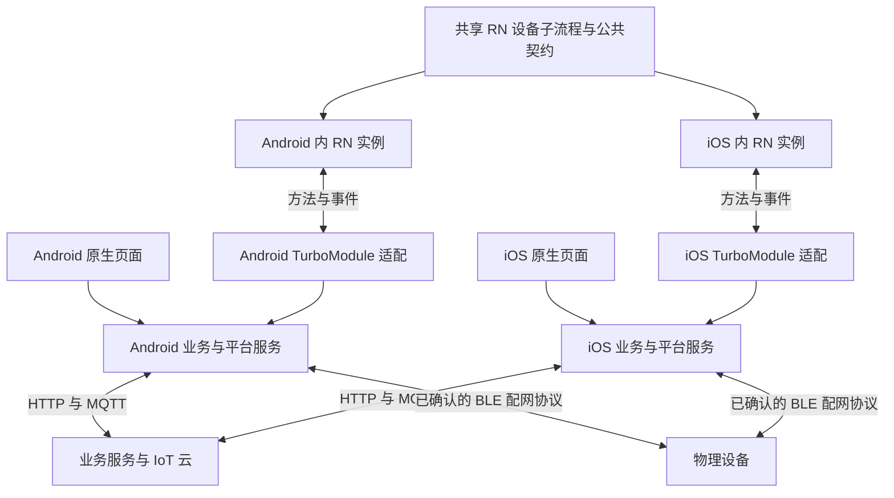

# Android、iOS 原生与 RN 架构及通信设计

> 原生与 RN 的完整专题现统一整理在 [架构及接入文档](../architecture/原生与RN完整架构及接入文档.md)，含源码引用、自动链接、构建配置片段、生命周期与发布约定。本文件保留分层背景及历史设计状态。

日期：2026-11-01。状态：目标架构设计；双端宿主、RN 工程、Codegen 和真实设备闭环尚未实现验证。TurboModule 为推荐通信方案，详细类型及版本在双端技术验证后冻结。

本设计按业务职责与最终结果组织，不沿用旧工程的 runtime、接口、状态机或导航结构。`app-rn-old/` 仅供理解业务和对照结果。与 [代码规范](原生与RN代码规范.md) 配合使用；此前方案中的目录和通信描述按本设计解释，历史验收记录不因此改变。

配套图示见 [架构图与时序图](架构图与时序图.md)，包含双端总体结构、设备页进出、控制确认及固件升级恢复。

## 1. 总体关系

- Android 和 iOS 分别是独立原生应用，各自嵌入 RN；两台设备或两种平台之间不通过 TurboModule 直接通信。
- 两个平台共享 RN 设备子流程、展示组件、产品展示映射及公共契约，各自实现平台服务和原生适配。
- RN 与当前宿主在应用内通信；宿主再通过 HTTP、MQTT、BLE 等与服务端及设备通信。TurboModule 不是网络协议，也不提供配网或 MQTT 实现。
- 原生页面与 RN 页面访问同一套原生业务服务，页面切换不会产生第二套账号、设备状态或连接。

图表示不同客户端的部署关系，不表示同一设备允许不受限的并发控制；实际会话与权限遵循正式业务及云端契约。

## 2. 分层与职责

| 层 | 责任 | 不承担的责任 |
| --- | --- | --- |
| 原生应用/导航 | 启动、账号、首页、添加、扫码、配网、我的、房间、全局设置及全局返回栈 | RN 设备页内部布局 |
| 原生业务服务 | 账号与租户、设备资料、状态、控制、定时、分享、解绑、升级任务 | 依赖页面或 RN 才能工作 |
| 原生平台/协议适配 | HTTP、MQTT、BLE、系统 Wi-Fi 能力、存储、权限、推送、深链、第三方 SDK | 将 SDK 类型泄漏到 RN 页面 |
| 原生 RN 容器 | 创建/挂载/卸载 runtime、传入设备入口、管理资源版本与容器上下文 | 把业务连接的寿命绑定到单个页面 |
| 原生 TurboModule 适配 | 校验调用上下文、数据转换、调用业务服务、发送类型化事件 | 重复实现账号、协议或任务状态机 |
| RN 宿主适配 | 对 Codegen 接口做 TS 封装，转换展示数据、订阅生命周期及业务错误 | 持有长期凭据和生产通信连接 |
| RN 用例及展示 | 控制、更多、设备内分享、定时、升级页面；内部导航、组件及交互状态 | 全局登录/导航、HTTP/MQTT/BLE、原生任务所有权 |

Android 建议 Kotlin 业务服务；iOS 建议 Swift 业务服务。按照 RN 0.86 官方接入方式，iOS 使用薄的 Objective-C++ 适配层连接 Swift 与 TurboModule；业务逻辑留在 Swift。具体 UI 框架、线程模型和工具链由双端集成验证后锁定。

Codegen 从公共类型规格生成平台接入代码，不生成业务实现、不实现鉴权、不自动保证两个平台的业务行为一致。双端通过同一语义契约和验收用例保持一致，不额外引入跨端业务框架。

## 3. 三类应用内通信

| 类型 | 方向 | 使用场景 | 设计原则 |
| --- | --- | --- | --- |
| 入口参数 | 宿主 → RN 根组件 | 设备 ID、产品 ID、初始子路由、容器上下文标识 | 作为入口，不将长期 Token 或整个服务对象放入 props |
| 业务方法 | RN → TurboModule → 原生服务 | 资料查询、控制、定时、分享、升级、宿主导航 | 异步请求与结果；有请求关联、错误、超时和明确取消语义 |
| 事件通知 | 原生服务 → TurboModule → RN | 设备变化、连接变化、任务进度、账号失效、偏好变化 | 类型化数据，带上下文及修订依据，可释放并可恢复 |

入口参数不是持续同步机制。语言、主题、单位及会话变化通过宿主上下文事件更新。RN 调用由 TS 适配层集中封装，展示组件不直接导入 TurboModule。

TurboModule 处理业务能力调用；如果未来确需在 RN 中嵌入自定义原生视图，另行评估 Fabric 原生组件。普通 RN 页面和现有 RN 控件不因使用 TurboModule 自动变成自定义原生组件。

## 4. 公共契约的组织

以下为逻辑接口组，不要求一组对应一个物理模块，也不代表接口名称或签名已冻结。

| 接口组 | 主要能力 |
| --- | --- |
| HostContext | 协议版本、能力清单、容器/会话上下文、语言、主题、单位及变化通知 |
| Device | 设备资料、物模型、可用能力、状态观察、属性控制及已授权设备动作 |
| DeviceBusiness | 设备设置、分享、成员、定时、解绑；按实际范围暴露 |
| FirmwareTask | 检查版本、启动升级、查询任务、订阅进度；取消仅在协议允许时提供 |
| HostNavigation | 打开已授权原生页面、系统分享、关闭设备子流程及返回结果 |

契约应覆盖：业务对象、字段单位、空值、枚举、错误码、权限、幂等性、取消、事件一致性、兼容条件。TS/Kotlin/Swift 保持同一语义。

Codegen 规格只使用所选版本支持的明确数据类型。跨边界传数据对象、数组和标量，不传 JS class、业务闭包、AbortSignal 或 SDK 实例。产品属性的可变类型用经 Codegen 验证的显式表示，不能用无约束 any 或未经校验的大 JSON 字符串隐藏契约。

版本与上下文字段按语义分开：

- 契约版本及能力：决定能否调用对应能力，不兼容时明确拒绝或采用已定义降级。
- 宿主实例/容器标识：隔离不同 runtime、页面实例及迟到回调。
- 会话修订：账号、租户、设备授权变化后使旧操作失效；标识不是权限凭证。
- 请求 ID：关联调用、结果、取消和日志；是否可重试仍依赖业务幂等约定。
- 设备 ID、任务 ID、观察标识与状态修订：界定事件所属对象、订阅及顺序。

宿主从可信会话确定权限并验证上下文，不能信任 RN 自报的用户或租户。返回脱敏错误；禁止暴露任意 URL 请求、方法执行或文件访问接口。

## 5. 状态所有权与生命周期

| 状态 | 权威所有者 | RN 处理方式 |
| --- | --- | --- |
| 登录、Token、租户和权限 | 原生账号服务 | 获取必要上下文及变化，不存第二套凭据 |
| MQTT/BLE 连接、协议状态及设备确认值 | 原生设备服务 | 观察快照和事件，保留展示副本 |
| 定时/分享等服务端数据 | 服务端最终权威，原生封装访问与缓存 | 调用业务接口并展示结果 |
| 设备固件升级任务 | 原生任务服务管理；真实状态以设备/服务端结果为依据 | 发起任务并观察，退出页面不等于取消任务 |
| 原生全局导航及 RN 容器 | 原生宿主 | 请求打开/关闭，不跳转旧 RN 首页 |
| RN 内部路由、输入、弹窗、选择状态 | RN | 按设备与容器上下文隔离 |
| 产品展示映射 | 可由共享 RN 配置维护 | 决定展示；原生仍校验真实物模型和控制权限 |

生命周期区分应用会话、设备服务、RN runtime、设备页面观察者和业务任务。释放页面观察不等于销毁 runtime，不等于断开设备连接，也不等于取消业务任务。

原生设备服务是否保持连接依据全部使用者、前后台和业务需要决定；不预设所有设备共用一个 MQTT 连接。账号失效或解绑后，原生撤销旧观察/请求并通知容器退出或重新进入合法状态。

## 6. 快照与事件的一致性

禁止简单地“读取快照完成后再开始订阅”，否则间隔中的变化可能丢失。

推荐按如下语义设计，具体方法签名在 Codegen 验证后确定：

1. RN 先安装类型化事件监听，开始缓存匹配入口上下文的事件。
2. RN 请求建立设备观察；原生在同一有序状态上下文中建立观察并捕获快照和修订 R，返回观察标识。
3. RN 渲染快照，筛选匹配观察标识的缓冲事件，只应用修订大于 R 的后续更新。事件可能先于方法结果到达，不能直接丢弃。
4. 事件重复或过期时忽略；发现连续性中断、缓冲溢出或重新进入前台时，按契约重新同步快照。
5. 离开页面时关闭原生观察并移除本地监听；迟到事件因观察标识和上下文失效而被拒绝。

没有活跃 RN 页面时，原生服务仍可维护业务状态，但不依赖 JS 回调交付最终结果。重新进入页面后从原生当前快照恢复，不假设事件具有无限持久化能力。

## 7. 典型业务链路

### 7.1 原生首页进入 RN 设备页

原生确认登录和设备权限 → 容器检查资源/契约兼容 → 创建或复用匹配 runtime → 传入设备入口 → RN 校验宿主能力并建立观察 → 展示设备页。

容器运行策略和预热先实测；不同完整 Bundle 不随意在同一 runtime 中拼接。退出设备子流程交由宿主处理，RN 子页内部返回由 RN 管理。

### 7.2 用户发送控制

RN 收集输入 → TS 用例/适配层提交请求 → TurboModule 验证调用上下文 → 原生业务服务校验权限、物模型及参数 → 协议适配器发送 → 云端/设备确认 → 原生更新状态 → 首页与 RN 观察同一结果。

RN 可显示待确认状态，但不得把方法已返回或 MQTT publish 成功直接当作设备已执行。超时明确区分已失败与结果未知，重试不自动重放不可幂等动作。

### 7.3 升级任务

RN 选择已确认版本并发起 → 原生管理实际任务与任务标识 → 方法返回已接受/已建立任务 → 进度事件更新 RN → 最终结果由设备/服务端确认。页面退出后按业务策略继续管理；重新进入以任务标识查询恢复。

取消请求等待与取消实际升级任务分开；后者只有协议支持且安全允许时执行。RN 资源更新与设备固件 OTA 是两个独立系统。

### 7.4 配网及解绑

配网全流程由原生页面和原生配网服务完成，不绕经 RN。绑定成功更新原生设备数据，再按业务流程展示或进入 RN。

RN 发起解绑 → 原生业务服务确认结果 → 撤销该设备授权/会话及观察 → 更新首页 → 宿主关闭设备流程。RN 不自行清空全局连接或跳转到旧路由。

## 8. 线程、取消、错误与事件负载

- 通过异步方法执行网络、存储及设备操作；TurboModule 适配入口不执行长时间阻塞任务，不预设其运行在 UI 线程。
- 原生 UI 导航切到平台要求的执行上下文；账号、任务和设备状态更新有明确串行化或隔离策略。
- Promise 不自带跨边界取消。通过请求标识定义取消协议，所有取消/结果竞争只能产生一个终态，业务结果未知时不能伪装成未执行。
- 页面清理、账号切换、runtime 销毁均清理所属回调和请求关联，不销毁不属于页面的业务服务。
- 状态更新可按设备/字段聚合，界定缓冲上限；控制确认、故障和任务终态不能被节流静默丢弃。
- RN 尽量传业务值和结构化状态，不反复跨边界传完整物模型、原始协议包或大量文件内容。

## 9. RN 资源装载与桥接的关系

容器决定加载哪个 Bundle；TurboModule 决定加载后的 RN 能调用哪些原生能力。两者相互配合，不互相替代。

包内默认资源先保证正式包脱离 Metro 可运行。若按范围获得动态发布实现授权，由独立原生资源管理器负责产品版本解析、兼容校验、签名/Hash 校验、原子安装、激活、健康检查和回退；版本/签名发布服务由明确的服务端责任方提供。

兼容性同时考虑平台、宿主、RN/引擎运行时、桥接能力、IoT SDK、物模型及 API。JS 包不能新增宿主没有的原生方法或依赖；此类变化通过新宿主版本发布。资源执行前校验，不能先加载 JS 再依靠 JS 判断不兼容。

Metro 负责开发与构建期 RN 打包，非生产手机常驻服务。Expo 模块仅在有明确用途并通过双端集成验证后保留；TurboModule 方案本身不要求保留整个旧 Expo 工程。

## 10. 源码与逻辑模块位置

| 位置 | 规划内容 |
| --- | --- |
| `app-rn/` | 设备入口、内部导航、功能页面、设计令牌、组件、产品展示映射、Codegen specs 与 TS 宿主适配 |
| `android-as/` | Android 应用入口、原生页面/导航、业务服务、SDK 适配、RN 容器和 Kotlin TurboModule 适配 |
| `ios-as/` | iOS 应用入口、原生页面/导航、Swift 业务服务、SDK 适配、RN 容器及薄 Objective-C++ 接入 |
| `docs/SDD/` | 公共契约语义、版本矩阵、线程/生命周期约定、验收证据及发布设计 |
| `app-rn-old/` | 重构前参考代码；不成为新工程的运行时依赖 |

逻辑分层不强制创建多项目、多包或新根级 Node 工作区。宿主显式配置 RN 依赖位置与 Codegen 输入；两端构建基于同一已冻结规格，生成文件由构建流程管理，不手改生成代码。

## 11. 验证顺序与完成标准

1. 双端宿主 + 同一 RN 示例入口 + 简单异步方法及事件，验证 Codegen、Swift 接入、页面进出及包内 Bundle。
2. 校验版本、会话隔离、错误、超时、取消、观察释放及快照/事件竞态；业务测试替身仅用于测试，不冒充真实通信。
3. 接入一个已确认产品，完成原生入口 → RN 真实控制 → 设备确认 → 原生首页和 RN 状态一致。
4. 扩展范围内定时、分享、解绑与升级任务；验证退出再进入、切账号、前后台及重连。
5. 完成视觉、性能和业务回归；有动态发布授权时再按代码规范验证坏包、不兼容、断网及回滚。

以上是技术验证及后续实施建议，不表示全部业务重写或发布平台建设已获授权。当前唯一业务范围表仍需恢复或确认正式位置后用于逐项范围核对。

## 12. 官方技术依据

本次评估以旧工程 RN 0.86.3 为候选，不代表新工程版本已冻结。实施前按最终版本再次查阅文档。

- [RN 0.86 Turbo Native Modules](https://reactnative.dev/docs/0.86/turbo-native-modules-introduction)
- [RN 0.86 原生事件](https://reactnative.dev/docs/0.86/the-new-architecture/native-modules-custom-events)
- [RN 0.86 Codegen](https://reactnative.dev/docs/0.86/the-new-architecture/using-codegen)
- [RN 0.86 Swift 接入](https://reactnative.dev/docs/0.86/the-new-architecture/turbo-modules-with-swift)
- [RN 0.86 Codegen 类型](https://reactnative.dev/docs/0.86/appendix)
