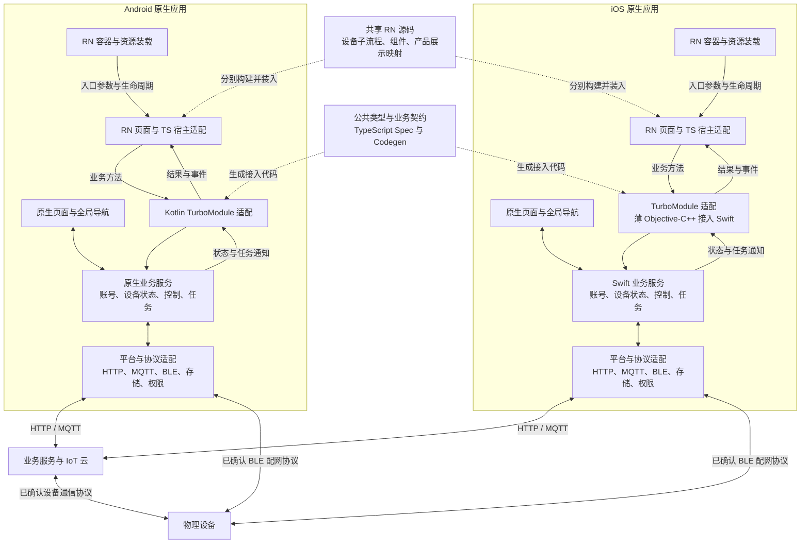
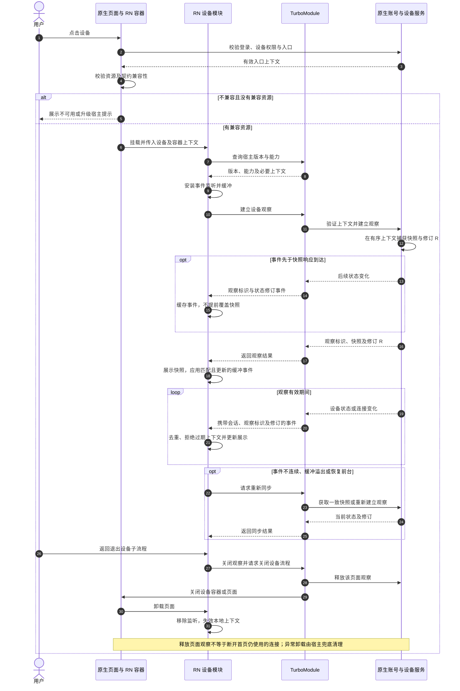
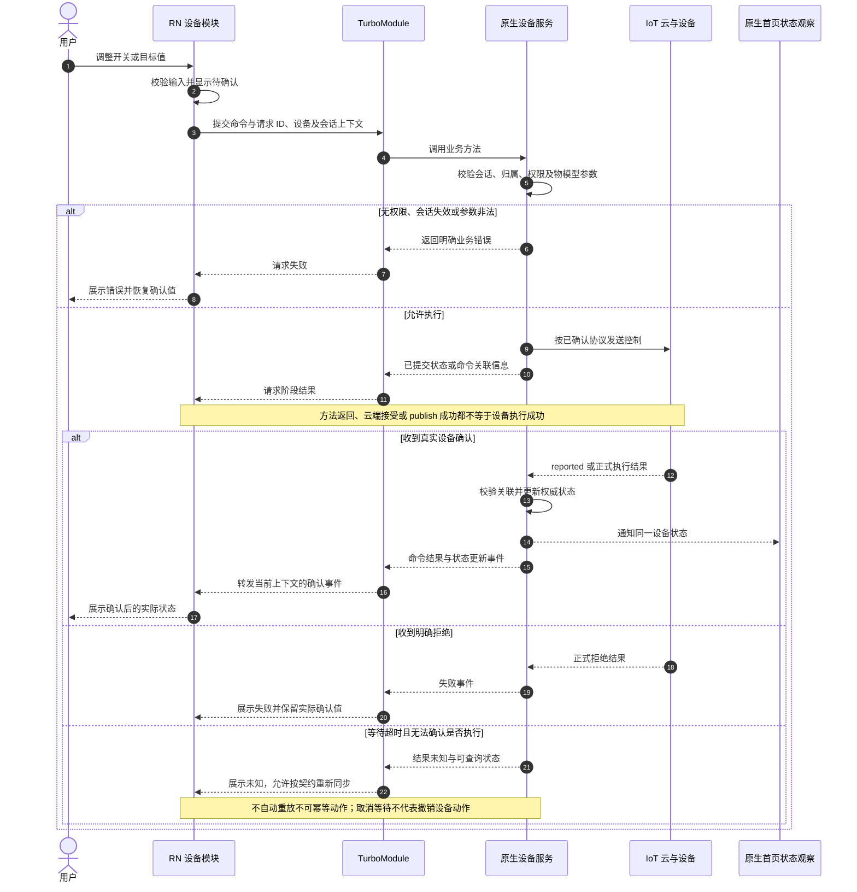
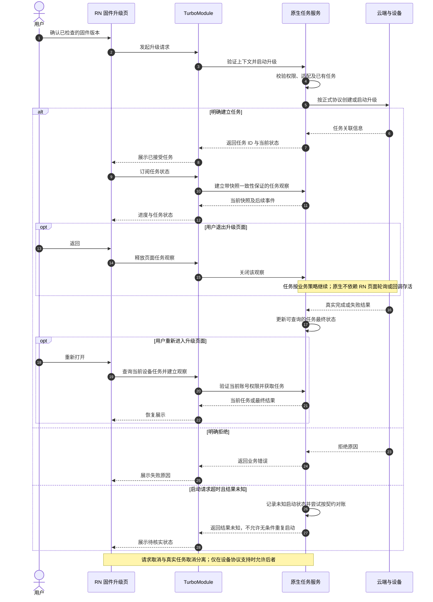

# 原生与 RN 架构图及业务时序图

> 历史设计稿：当前架构入口为[架构总览](../architecture/架构总览.md)及其 7 份专题。以下保留原日期、方案和状态，不作为当前工程就绪或验收结论。

日期：2026-11-01。依据：[架构及通信设计](原生与RN架构及通信设计.md) 与 [代码规范](原生与RN代码规范.md)。

以下为目标设计图，不表示双端宿主、桥接或资源发布能力已经实现。接口名称为语义示意，签名与版本待双端验证后冻结；业务流程与最终结果按正式需求验收，旧实现不约束新设计。

## 1. 总体架构

实线表示运行时调用、数据或通信关系；虚线表示共享源码、构建期生成及资源供给，不表示两个平台直接通信。

- Android 与 iOS 是不同客户端部署；共用 RN 源码和契约，不通过 TurboModule 互相通信。
- 原生页面与 RN 页面共用当前宿主的业务服务。原生服务不依赖 RN runtime 才能工作。
- TurboModule 是应用内通信适配，HTTP/MQTT/BLE 是对外通信；两者职责不同。
- 容器负责加载与页面生命周期，业务服务负责真实会话与任务。远程资源签名、灰度和回滚属于另行授权后的资源治理，不由 TurboModule 自动提供。

## 2. 进入设备页、状态同步与退出

此图为两端共用语义。RN 参与者包含设备用例和 TS 适配；原生参与者分别由 Kotlin/Swift 实现。

## 3. 设备控制及首页状态一致

图中“已提交”仅是调用阶段，最终执行结果须由设备/正式协议确认。明确拒绝与结果未知不得混为一谈。

## 4. 固件升级、退出页面与恢复

此图针对设备固件 OTA，不是 RN Bundle 更新。任务在原生管理，真实升级结果来自正式设备/云端契约。

## 5. 阅读与实施约束

- 本文件中的 Mermaid 源码可直接用于支持 Mermaid 的 Markdown 阅读器；总体图区分两端部署，时序图描述两端共同遵守的语义。
- 正常控制链路使用已确认的云端/设备契约；BLE 线表示配网能力，不授权新增离线控制通道。
- RN Bundle 动态装载的签名、兼容、原子安装、灰度及回滚另按范围与资源发布设计实施，不由这些业务图代替。
- 双端构建、真实设备结果、状态一致性、取消及退出恢复均需实际验证；图中关系不是当前已交付能力的证明。
