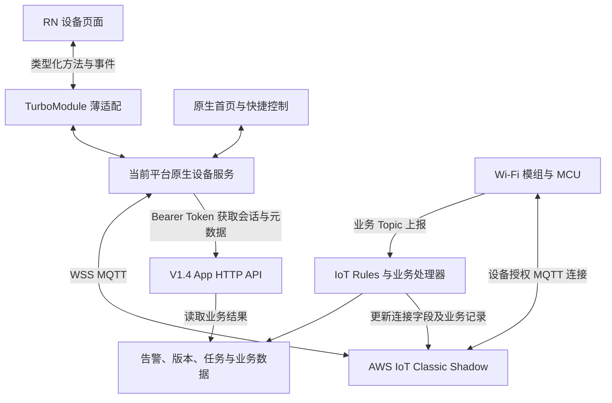
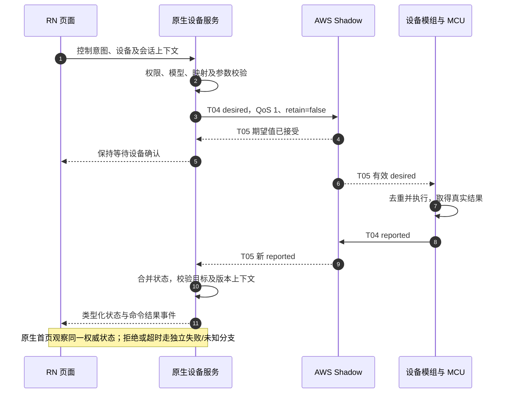

# MQTT 架构与完整流程

日期：2026-11-01。性质：需求梳理与目标设计，不是部署、构建或端到端验收证明。

原生服务、RN 桥接及构建接入的集中说明见 [原生与 RN 完整架构及接入文档](原生与RN完整架构及接入文档.md)。

## 1. 依据与阅读规则

| 依据 | 本文采用内容 |
| --- | --- |
| [V1.6 Corrected](../prd/ROWAN_AS_App_Spec_V1.6_Corrected.docx) §10.1～10.10 | MQTT 通道、字段、三端职责、控制确认、频率及验收的主要依据 |
| [V1.4](../prd/ROWAN公共App产品功能及API详细设计说明书_V1.4.docx) DEVICE-01/02、§5.7、§8.17 | HTTP 会话、设备、产品及物模型边界；不沿用其中旧 MQTT Topic 表 |
| [当前架构设计](../SDD/原生与RN架构及通信设计.md)、[代码规范](../SDD/原生与RN代码规范.md) | 原生持有通信服务、RN 展示、桥接及生命周期 |
| [物模型架构与流程](物模型架构与流程.md) | 能力定义、版本、产品映射和校验 |

标记含义：**需求约束**来自正式参考；**设计建议**为待落地方案；**待确认**表示原文不足以冻结实现。示例不是全产品字段全集，不是生产凭据，也不代表实际服务已经提供。

业务范围仍受根 AGENTS.md 指定的唯一范围表约束，该表当前在工作区缺失，实施逐项业务前须恢复或确认正式位置。本文不授权新增业务或发布平台，也不让旧代码实现约束重构。

V1.6 §10.1 明确采用 AWS Classic Shadow，替换旧 property、service、event Topic 表；它不因此替换当前阶段 V1.4 的 HTTP/App 功能和接口范围。V1.6 文中引用的原 Android/iOS 来源与本仓库 app-rn-old 不是同一份工程。

## 2. 核心结论

- **需求约束**：属性查询、即时控制及状态同步使用 Classic Shadow；App 写 desired，设备写真正执行后的 reported。
- AWS 接受期望值不等于设备已经执行；UI 最终依据真实 reported 或已确认的任务结果。
- MQTT 建连成功只表示客户端连上 Broker，不证明物理设备在线；设备在线按产品连接字段及有效状态判定。
- App 不直接订阅所有设备业务 Topic；设备和云端各自承担连接、告警、业务请求、版本及升级上报。
- QoS 1 存在重投可能，必须做有界重试、去重及幂等；重连不能自动重放未确认的一次性动作。
- 原生管理凭证、连接、订阅、协议和权威状态，RN 仅经业务桥接观察及操作。

## 3. 参与方与架构



图中的客户端结构在 Android/iOS 各自实现；TurboModule 是应用内通信，不是网络协议。模组与 MCU 的串口细节不由本 MQTT 文档重新定义。

| 参与方 | 权威职责 |
| --- | --- |
| 原生 App 服务 | 安全管理临时凭证、连接及观察、校验权限/模型、命令状态与会话隔离 |
| RN 页面 | 展示状态、收集输入、显示等待/失败/未知，不持有生产连接或长期凭据 |
| Broker/Shadow 服务 | 连接授权及影子读写、accepted/rejected、版本与存储状态 |
| 设备模组/MCU | 校验有效 desired，执行真实动作，按实际结果报告 reported；处理重复命令 |
| 云端业务程序 | Topic 路由、连接状态、告警、业务响应、版本及 OTA 记录，不能代设备伪造实际控制结果 |

## 4. 设备标识、凭证与授权

### 4.1 标识不能混用

| 标识 | 含义及规则 |
| --- | --- |
| 业务设备 ID | App API 与业务记录标识；与 thingRef 是否相同必须由接口确认 |
| MQTT deviceID | V1.6 §10.2 指定为会话返回的 AWS thingName/thingRef；用于 Shadow Topic |
| productID | 设备注册所属产品，不是品牌、品类或型号名称 |
| clientID | 当前 MQTT 客户端标识，由正式会话契约提供，不用设备 ID 或硬编码值随意替换 |
| clientToken | 可选 Shadow 请求关联值，不是 Token 凭据，不证明设备执行，也不自动透传到设备后续上报 |

MAC、SN、数据库数值主键与 thingRef 不默认相等。原生保存经过验证的映射，并用当前账号、绑定关系和授权校验设备身份，不能只信任报文内 DeviceId。

### 4.2 会话接口

**需求约束，V1.4 DEVICE-01**：`GET /api/app/devices/{deviceID}/mqtt`，Bearer Token，返回临时连接信息。主要字段为 host、endpoint、path、clientID、username、password、deviceID。专属错误包括 1331 设备不存在、1332 未绑定。

host 示例为 WSS 地址；实际鉴权模式必须由后端冻结。App 临时凭证与物理设备 X.509 证书不是同一身份，不能混用。

**需求约束**：凭证短期有效，过期前重新获取。**待确认**：响应目前未明确列出 expiresAt、刷新提前量、凭证更换后是否必须重连及有效 Topic 权限的机器可读表示。不能从旧代码签名参数推导凭证寿命。

**设计建议**：原生按正式有效期刷新，合并并发刷新请求；更新凭证时管理连接切换和重新同步。账号失效或解绑后清理对应凭证、订阅与请求；网络恢复不意味着权限自动恢复。

## 5. Topic 完整矩阵

定义 `S = $aws/things/{thingRef}/shadow`、`B = {productID}/{thingRef}`。下表的 thingRef 即 V1.6 模板中的 deviceID；实际 Topic 没有 S/B 这两个占位字母。

| 编号 | 完整路径展开规则 | 发布方 | 订阅/处理方 | App 职责 |
| --- | --- | --- | --- | --- |
| T01 | S/get | App、设备；云端仅诊断需要时 | AWS Shadow | 查询当前快照 |
| T02 | S/get/accepted | AWS Shadow | App、设备 | 初始化 reported |
| T03 | S/get/rejected | AWS Shadow | 发起查询的客户端 | 错误处理，不伪造默认状态 |
| T04 | S/update | App desired、设备 reported、授权云端程序 | AWS Shadow；云端规则按需消费 reported | 提交期望值 |
| T05 | S/update/accepted | AWS Shadow | App、设备 | 区分期望接受与真实报告 |
| T06 | S/update/rejected | AWS Shadow | App、设备及发起更新的云端程序 | 结束等待并处理冲突/拒绝 |
| T07 | B/connect | 设备；异常断连可由 Broker LWT 代发 | 云端规则 | 不直接订阅，读取 Shadow 连接字段 |
| T08 | B/notice | 设备 | 云端告警处理器 | 不直接订阅；按范围通过既有业务接口获取结果 |
| T09 | B/callapi/Req | 设备 | 云端业务处理器 | 不参与 |
| T10 | B/callapi/Resp | 云端业务处理器 | 原请求设备 | 不参与 |
| T11 | B/mcu/version | 设备 | 云端版本处理器 | 通过设备详情/OTA 检查接口获取 |
| T12 | B/mcu/ota | 设备，升级阶段/进度/结果上行 | 云端 OTA 任务处理器 | 通过 OTA-05 获取任务结果 |
| L01 | B/mcu | 实际使用旧路径的固件 | 云端兼容映射器 | 不参与，和 T11 按 profile 择一 |
| F01 | S/get/# | 无发布方，这是订阅过滤器 | 可保留的旧客户端配置 | 可替代 T02/T03，不能与精确订阅重复配置 |

**需求约束**：新 App 精确订阅 T02、T03、T05、T06；全部订阅成功后再发布 T01。App 和设备不直接订阅 T04 请求通道。设备另订阅自身 T10。不要默认订阅 shadow/#、跨设备 +/# 或全部业务 Topic。

V1.6 §10.4.5 沿用设备订阅 update/accepted 的方式，不擅自切换到 update/delta；AWS 标准支持更多 Topic 不代表本项目都要启用。

Topic 不带前导/额外尾斜杠，Req/Resp 及字段大小写原样保留。JSON 为 UTF-8；get 可以是零字节空消息。App 控制发布使用 QoS 1、retain=false，订阅 QoS 与授权通过正式配置确认；业务发布联调默认同样 QoS 1、retain=false，旧固件差异单独核验。

## 6. Shadow 报文与确认语义

以下仅重述 V1.6 示例产品，不授权把 Power=1 或字符串取值套给所有产品。真实属性类型、值域、单位和原字段由已发布物模型及产品协议映射确定。

App 向 T04 提交期望：

```json
{"state":{"desired":{"EnduserId":"demo_user001","DeviceId":"demo_dev001","CommandType":"app","Power":1}},"clientToken":"app_cmd001"}
```

AWS 接受期望后的 T05 示例：

```json
{"state":{"desired":{"Power":1}},"version":101,"clientToken":"app_cmd001"}
```

设备确认执行后上报，随后 T05 返回的示例：

```json
{"state":{"reported":{"DeviceId":"demo_dev001","Power":1}},"version":102,"clientToken":"device_report001"}
```

- desired 不能写入实际状态缓存冒充 reported。云端只允许更新其负责的计算字段，例如经过有效连接事件判定的 ConnectType。
- clientToken 只能关联某次 Shadow 请求/响应。设备报告可有不同 clientToken，也可按正式协议不携带，不能要求它等于 App 命令 token。
- version 用于新旧及乱序判断，不能单独证明消息来源或操作成功。确认仍需检查 reported、目标字段和有效时序/上下文。
- 部分更新按字段合并，缺失字段不清空缓存。显式 null、嵌套对象、数组及分支删除按正式 Shadow 语义与具体模型处理，不能把所有字段当成标量或把整个增量当完整快照。
- 一个响应的不同语义应分别处理，不能依赖互斥分支假定报文永远只包含一个有用信息。
- 清洁重置等动作保留产品原有计次、清零或流水号语义，不能新造 service/call、service/reply 平行通道，也不能用“属性恰好相同”草率确认一次性动作。

## 7. App 连接与初始化流程

1. 原生验证登录、租户、绑定关系，取得业务设备与 productID。
2. 获取匹配的产品运行配置及已发布物模型；解析业务 ID 与 thingRef 的映射。
3. 调用 DEVICE-01 取得当前设备临时会话，验证 WSS 目标、身份和参数完整性。
4. 创建连接并等待建连结果。创建失败区分鉴权、配置和临时网络故障。
5. 注册消息处理并订阅四个响应 Topic，确认订阅授权成功。
6. 发布 get，等待 accepted/rejected 或有界超时。get 是读取影子，不强制设备立即全量上报。
7. 以有效 reported 初始化缓存，核验模型字段；未确认值保持未知，不填充全零。
8. 将设备快照与后续变化提供给原生首页及 RN 设备页；控制资格还要结合权限、在线及能力。

**设计建议**：设备连接状态至少区分未连接、连接中、同步中、已同步、重试等待、鉴权失效和关闭；设备在线状态另行维护。状态名称属于本地设计，不能当成新增服务端枚举。

## 8. 控制完整时序



**需求约束**：记录期望值和操作时刻；发送中、云端接受、设备确认、明确拒绝、结果未知必须可区分。高频连续操作采用最后有效目标，不能让旧回报覆盖新意图。

**设计建议**：可合并连续目标值，但一次性动作单独排队或拒绝并明确提示；合并策略与幂等性按产品冻结。原生请求 ID、Shadow clientToken 与设备业务序号分别建模，不能擅自要求设备新增未约定字段。

## 9. 断线、续期、重连与恢复

- **需求约束**：保留最近确认值并标注当前通信不可用；不得继续显示未确认成功。恢复后重新订阅并 get。
- **设计建议**：有上限的指数退避与抖动，合并并发重连；账号切换、解绑和运行时终止使旧请求及回调失效。
- 401/403 等鉴权失败修复授权，不无限自动重连。凭证过期按正式续期协议重新获取，不能把任意鉴权失败都归因为网络。
- 重连后获取新快照，不自动重发旧控制或清洁重置等动作；必要时查询当前状态并提示用户重新确认。
- 连接前后台策略遵守平台限制，不承诺 iOS/Android 退后台后 MQTT 永远常驻。业务需要与重连时机须明确，RN 页面退出不直接决定底层连接寿命。
- 页面释放自身观察；原生服务按全部使用者决定连接回收，首页和设备页不互相关闭对方仍需的会话。
- App 重建本地订阅后以“观察建立 + 快照修订 + 缓冲事件”保证 RN 不漏状态，详见架构设计；本地桥接事件不等于新的云端 MQTT Topic。

## 10. 云端与设备业务流程

| 业务 | 完整处理链路 |
| --- | --- |
| 在线/离线 | 设备连接后 T07 上线；异常断线由连接时登记的 LWT 或有效事件确认离线；云端更新连接记录及 reported.ConnectType；App 经 T05 展示 |
| 故障 | 设备 T08 → 云端按产品/设备/故障去重并记录新增与解除 → 已授权业务接口提供结果；不凭示例新增 App 消息中心 |
| 业务请求 | 设备 T09 → 校验 Topic 归属 → 业务处理器执行并幂等保存结果 → 仅向原请求设备 T10 响应 |
| MCU 版本 | 设备识别 MCU 后 T11，升级后版本变化可补报 → 云端维护版本 → 设备详情与 OTA 检查返回 |
| MCU OTA | 按原 OTA 任务链触发 → 设备 T12 上报阶段/进度/结果 → 云端更新任务 → App 经 OTA-05 查询；成功结合最终设备结果与新版本 |
| 旧 MCU 路径 | 只有已确认旧固件使用 L01；映射到相同版本记录，不与 T11 同时重复发送/入库 |

正常主动 DISCONNECT 不保证触发 LWT，主动离线和异常失联分别设计与测试。LWT 是 Broker 根据连接约定发布，不是断电设备主动发消息。

V1.6 的业务 JSON 如 requestId、taskId、progress 仅为联调示意，必须映射真实产品/固件字典。T12 是上行，不据此新增下行 ota/notify 或把下载完成当刷写成功。

### 云端规则职责

| 规则 | Topic 过滤器 | 主要校验及处理 |
| --- | --- | --- |
| R01 | +/+/connect | 提取产品/设备，按连接会话与时间更新在线状态 |
| R02 | +/+/callapi/Req | 授权路由及幂等响应，不能从 payload 任意指定响应目标 |
| R03 | +/+/notice | 告警与解除去重 |
| R04 | $aws/things/+/shadow/update | 仅处理 state.reported，按物模型处理；不以 desired 统计实际状态 |
| R05 | +/+/mcu/version | MCU 版本记录 |
| R06 | +/+/mcu/ota | 任务状态及终态，不反复触发升级 |
| R07 | +/+/mcu | 仅旧 profile 兼容映射 |

产品业务 Topic 的产品/设备分别在第 1/2 层，Shadow 的 thingRef 在第 3 层。路由依据可信授权和 Topic，不允许 payload 同名字段覆盖云端提取值。connect 写回产生新 reported 后不能无限反馈写回。

以上是需求中的规则职责与过滤器，不是生产可直接部署的完整 SQL。使用 Publish 和直接 Shadow API 时须验证实际事件路径，不能假设会触发同一原始 MQTT 请求；SaaS 不需要为了消费规则另建常驻 MQTT 长连接。

## 11. 异常与展示

| 场景 | 要求 |
| --- | --- |
| 未绑定/身份不一致 | 拒绝获取或使用会话，不订阅外部设备 |
| get/rejected 404 | 显示影子暂不可用，不伪造全零；设备确认本地真实状态后按正式流程创建 reported |
| 鉴权错误 | 撤销可操作状态，按授权/续期契约恢复，不无限重试 |
| update/rejected 409 | 结束等待、恢复最近确认值，重新同步；是否重发由业务决定 |
| publish 或等待超时 | 区分未发送、已发送但未知、明确失败；不宣称设备未执行或已执行 |
| malformed/外部设备/未知字段 | 不确认成功；按模型与正式映射处理，脱敏记录异常 |
| 乱序/重复 | 按版本和请求/设备上下文丢弃旧数据，幂等处理；状态相同不等于新动作执行 |
| 显式属性删除 | 清除该值并使依赖能力重新评估，不继续使用旧在线/成功值 |
| 设备离线 | 结束或标记未确认动作，禁用不允许离线执行的控制，保持最后确认值与离线标识 |

超时秒数、最大重试次数和具体错误结构为待冻结设计，不把旧代码 10 秒超时当成性能验收目标。

## 12. 上报频率与性能验收

以下为 **V1.6 §10.8 的目标约束**，不是本次测量结果。周期限流不得阻挡命令执行确认和关键事件。

| 场景 | 文档执行口径 |
| --- | --- |
| 全属性周期 | 间隔 >1 小时；无变化不重复全量，启动/恢复同步单列 |
| 待机周期 | 间隔 >1 分钟，无变化不报 |
| 普通运行周期 | 增量间隔 >20 秒，合并变化字段 |
| 控制确认/关键变化 | 实时增量，不受上述周期门限阻塞 |
| notice、callapi/Req | 相同内容去重，必要重复重试间隔 >1 分钟；新事件/响应不按重复消息节流 |
| mcu/version | 通电识别后一次，升级成功后的版本变化可补报 |
| mcu/ota | 阶段或有意义进度变化上报，终态及时上报 |

正常网络下设备状态到 App 展示、App 操作到 MCU 有效接收确认、Shadow accepted、轻量 callapi 响应、设备 OTA 状态到云端、连接后上线通知的目标分别为 <500 ms，按各自起止点测量；不含压缩机物理启动或完整固件下载刷写时间。

离线分为失联检测时延与检测后分发时延；后者目标 <500 ms，突然断电总时延依据保活/检测机制实测，不能承诺固定 500 ms。Wi-Fi 与蜂窝网络在目标区域各类至少记录 100 次操作，给出 P50、P95、最大值、失败数及可关联的端云时间记录；弱网与跨区域另列。

## 13. 安全、日志与验收清单

- 当前账号仅访问已绑定授权设备；物理设备证书限制本设备 Topic，云端校验产品与设备对应关系。
- TLS、临时凭据和证书校验遵循正式安全配置；禁止记录 Token、密码、MQTT 密钥、STS 签名 URL 或设备秘密。
- 脱敏日志关联完整源码 Commit、产品/固件 profile、客户端会话、请求、Topic 类别与版本；不把全量原始报文直接写入生产日志。
- 联调需提交 T01～T12 的发布方、完整 Topic、原始/接收 Payload；启用 L01 时补齐其映射及证据。原始证据受控保存，不等同于公开日志。
- 覆盖 404、409、鉴权、断网、重连、重复、乱序、旧离线覆盖、越权、结果未知及一次性动作不重放。
- 提交云端规则、动作目标、处理函数、队列/表和负责人，验证实际消费链路。
- 双端原生与 RN 显示同一权威状态，页面进出和切账号不泄漏订阅或串数据。

## 14. 旧工程对照与待确认项

旧实现仅为行为参考，不约束重构。以下为静态阅读结论，不能代替真实固件/云端验收。

| 项目 | 已观察到的旧工程行为 | 重构关注 |
| --- | --- | --- |
| 通道与发布 | 四个响应精确订阅、零字节 get、QoS 1/retain=false | 保留协议结果，不必保留类结构 |
| 确认 | 分开处理自身 desired accepted 与较新目标 reported，不强求设备 token 等于 App token | 用真实完整报文验证相关与乱序，不把具体旧算法冻结为协议 |
| 恢复 | 上层托管退避重连，重取凭据并查询，不自动重放命令 | 原生重新实现生命周期 |
| 产品覆盖 | 开发/预览 profile；一般产品只读，测试产品 prd_100/tm_1 配置开关 | 补齐真实产品字段及动作契约 |
| 在线字段 | 首页读取 ConnectType，测试产品 profile 使用 Online | 原生统一产品映射及有效性判定 |
| 续期 | 连接时重取凭据，未见按有效期提前刷新 | 补齐服务端有效期与客户端续期契约 |
| 标识 | 强制页面设备 ID 等于 MQTT 返回 deviceID | 冻结业务 ID/thingRef 映射后验证 |

参考：[Shadow 适配](../../app-rn-old/src/protocol/classic-shadow.ts)、[会话确认](../../app-rn-old/src/protocol/device-session.ts)、[重连管理](../../app-rn-old/src/protocol/managed-session.ts)、[传输](../../app-rn-old/src/protocol/mqtt-browser.ts)、[产品配置](../../app-rn-old/src/config/development-products.ts)。

实施前待确认：每产品/固件原始字段与动作确认、DEVICE-01 实际鉴权及有效期、ID 映射、Client ID 并发限制、MQTT 版本/保活/重连参数、在线事件顺序依据、OTA 触发与查询对账契约、云端负责人和真实 Topic 权限。文档给出示例不表示这些均已部署。

## 15. 标准与来源定位

V1.6：§10.1 总结、§10.2 标识及约束、§10.3～10.5 Topic/报文/订阅、§10.6 云端规则、§10.7 控制状态机、§10.8 频率与性能、§10.9 验收、§10.10 来源。V1.4：DEVICE-01/02、PRODUCT-01、THING-01。本文不以 V1.6 的非 MQTT 功能覆盖 V1.4。

AWS 标准仅补充标准语义，不自动扩充项目启用的通道：

- [Device Shadow MQTT topics](https://docs.aws.amazon.com/iot/latest/developerguide/device-shadow-mqtt.html)
- [Shadow documents](https://docs.aws.amazon.com/iot/latest/developerguide/device-shadow-document.html)
- [Shadow data flow](https://docs.aws.amazon.com/iot/latest/developerguide/device-shadow-data-flow.html)
