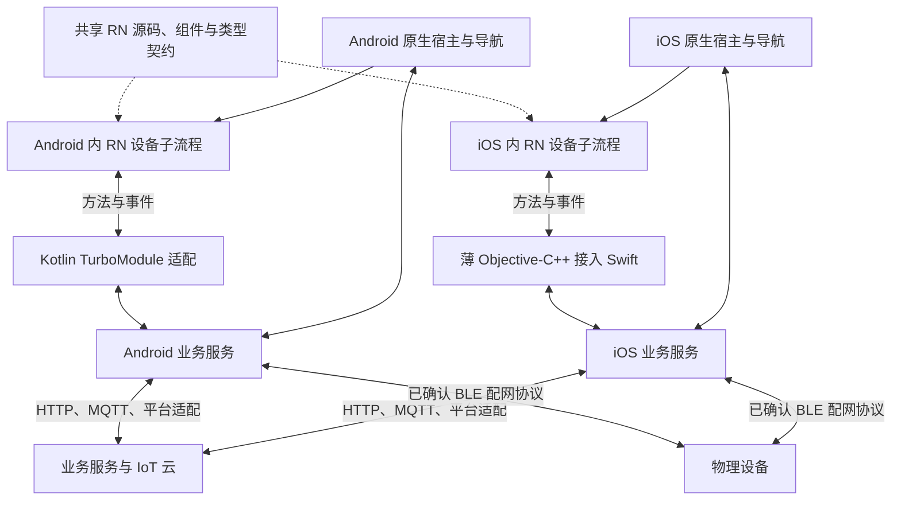
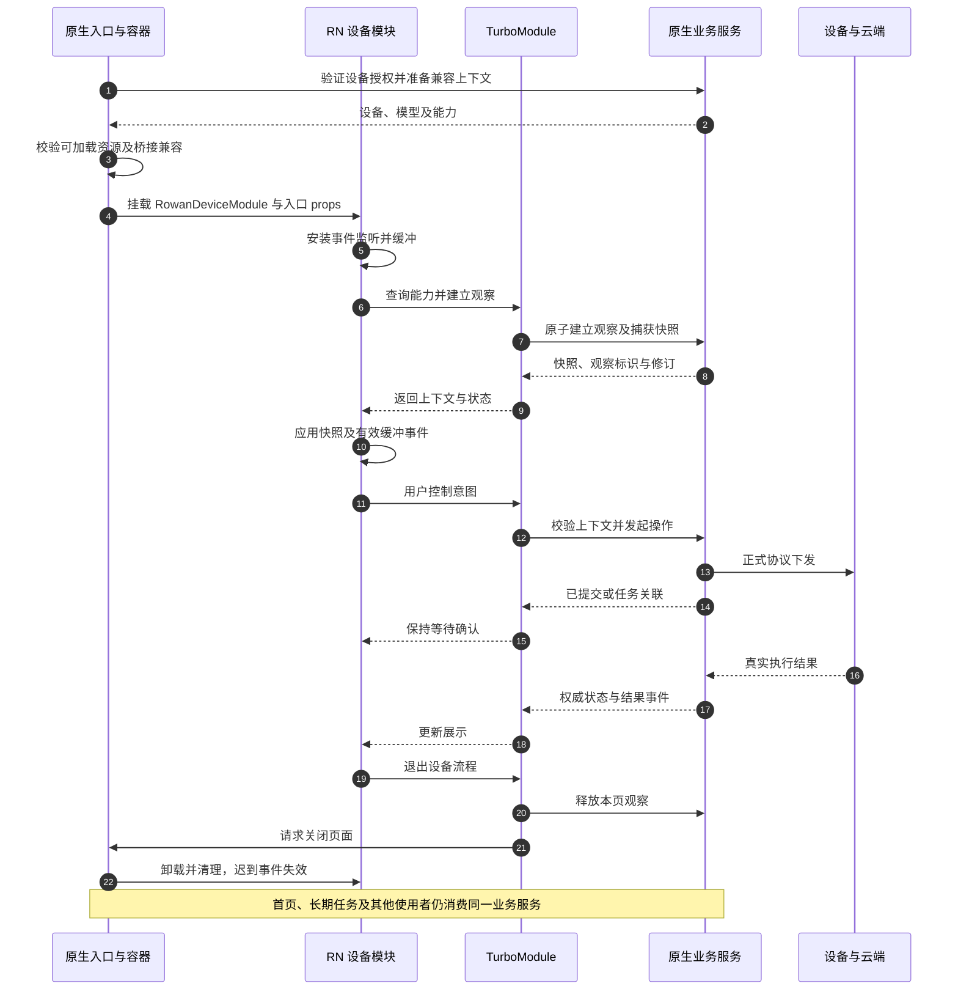
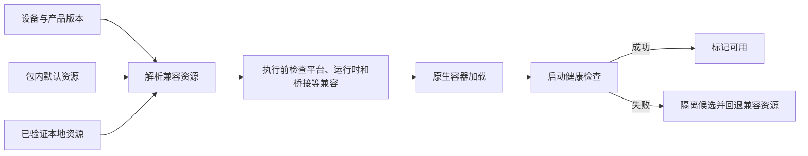

# Android、iOS 原生与 RN 完整架构及接入文档

日期：2026-11-01。状态：当前目标架构与接入约定，尚未完成双端集成和业务验收。本文整合项目关系、源码集成、桥接、状态、容器、资源和构建，是本专题的集中阅读入口。

## 1. 依据、范围与当前状态

| 依据 | 采用内容 |
| --- | --- |
| [V1.4](../prd/ROWAN公共App产品功能及API详细设计说明书_V1.4.docx) | HTTP 接口、App 功能与业务流程、产品/物模型/插件接口 |
| [V1.6 Corrected](../prd/ROWAN_AS_App_Spec_V1.6_Corrected.docx) | 仅 MQTT Topic、报文、确认、三端职责及相关验收 |
| [蓝湖入口](../ui/蓝湖地址.txt) | 页面视觉样式；本地导出图辅助核对 |
| [代码规范](../SDD/原生与RN代码规范.md) | 实现、评审、安全及交付标准 |
| [MQTT 架构与流程](MQTT架构与流程.md) | 连接、控制、云端/设备职责、恢复与验收细节 |
| [物模型架构与流程](物模型架构与流程.md) | 产品能力、设备页初始化、版本、映射及缓存 |

重构以正式业务流程、协议语义、视觉和最终可观察结果一致为目标，可重新设计或重写实现。app-rn-old 不约束新接口、状态机、导航、依赖及代码组织，不复刻旧缺陷。

当前 android-as、ios-as、app-rn 已有职责目录和说明，但没有正式 Gradle/Xcode/RN 构建工程、应用入口、依赖锁文件或业务代码。旧工程检查结果不证明新工程可运行。

唯一业务范围表为用户确认的 docs/prd/智能家居物联网项目计划&需求范围.xlsx；SDD 中同名表为相同内容的副本。本文是方案整理，不扩大业务范围；动态资源签名、灰度、回滚及服务端发布治理按已有规则补齐范围授权后实施。

下文的“目标约定”表示当前设计，“候选/建议”表示需技术验证，“待确认”表示尚不能冻结实现。配置代码块仅为 RN 0.86 候选方案的关键片段，不是完整已可运行配置。

## 2. 接入方式与当前选择

| 维度 | 可选方式 | 当前计划 |
| --- | --- | --- |
| 应用主导权 | RN 主导全局应用；原生主导并嵌入 RN | 原生主导，RN 承载设备子流程 |
| 工程集成 | 源码集成 Integrated；预编译库隔离集成 Isolated | 源码集成，两端构建显式引用 app-rn |
| 原生业务能力调用 | TurboModule/Codegen；其他经验证的模块方案 | 推荐 TurboModule + Codegen，双端验证后冻结 |
| 原生到 RN 通知 | 类型化事件及入口参数 | 入口参数初始化，持续变化通过事件 |
| 自定义原生视图 | Fabric 组件 | 仅有明确需要时另行评估，不替代业务模块 |
| Expo | 可评估模块或 Brownfield 工具 | 不整体继承旧 Expo 工程，仅按用途与兼容验证决定保留模块 |

源码集成意味着原生构建参与 RN 依赖、自动链接、Codegen 及资源集成。分成三个目录不等于“隔离预编译接入”。首版不要求先生成 Android AAR/iOS XCFramework 再作为黑盒库接入；以后若调整此策略，另行验证版本和交付流程。

TurboModule 是应用内调用机制，不是宿主工程接入方式，也不提供 MQTT、配网、资源发布或鉴权实现。Codegen 生成类型接入代码，不生成 Kotlin/Swift 业务逻辑。

## 3. 总体架构与部署关系



Android 和 iOS 是两个独立客户端部署，各自运行 RN，不通过 TurboModule 跨平台直接通信。虚线表示共享代码分别集成，实线表示运行时关系；图不授权新增离线设备控制或其他通信通道。

## 4. 页面与服务职责

| 内容 | 页面归属 | 服务/状态归属 |
| --- | --- | --- |
| 启动、账号、注册/找回、协议及地区 | 原生 | 原生账号、配置及内容服务 |
| 首页、设备列表、房间分组及快捷控制 | 原生 | 原生设备与业务服务 |
| 添加、扫码、发现、Wi-Fi 输入及配网 | 原生 | 原生权限、BLE/Wi-Fi 及配网状态机 |
| 我的、房间管理及全局设置 | 原生 | 原生业务服务 |
| 设备控制、更多、设备内分享、定时 | RN | 原生业务接口及设备权威状态 |
| 设备固件升级页面 | RN | 原生任务管理，最终状态来自设备/云端 |
| 权限、存储、推送、深链、第三方 SDK | 原生承接 | 原生平台服务，仅启用范围内能力 |
| RN 内部路由、输入、弹窗与局部选择 | RN | RN 展示状态，按容器及设备隔离 |
| RN runtime 和资源版本 | 原生容器 | 原生宿主与资源管理器 |

原生页面和 RN 适配层都调用同一原生业务服务，不能各自维护一套设备连接、登录态或任务。UI 不直接操作 SDK。业务服务不反向依赖页面或 RN runtime，页面关闭后仍能按业务需要工作。

## 5. 目录与工程标识

```text
rowan-iot-app/
├─ android-as/                   Android 正式宿主
│  └─ app/src/main/kotlin/com/rowan/iot/
│     ├─ app/、navigation/、features/ 原生入口、导航及页面
│     ├─ domain/、data/、platform/   业务、数据协议与平台实现
│     └─ bridge/、rnhost/、design/   桥接、容器及原生设计令牌
├─ ios-as/                       iOS 正式宿主
│  └─ Rowan/
│     ├─ App/、Navigation/、Features/
│     ├─ Domain/、Data/、Platform/
│     └─ Bridge/、RNHost/、Design/、Resources/
├─ app-rn/                       共享 RN 设备模块
│  ├─ src/entry/、navigation/、features/、components/
│  ├─ src/application/、models/、products/、design/
│  ├─ src/host/specs/             Codegen 类型规格
│  ├─ src/host/adapter/           TS 宿主接口封装
│  └─ assets/、tests/、config/、scripts/
├─ app-rn-old/                   旧应用，仅业务理解与结果对照
└─ docs/architecture/            本文及 MQTT、物模型专题
```

| 标识 | 目标约定 |
| --- | --- |
| Android 工程/module | RowanAndroid / app |
| Kotlin namespace | com.rowan.iot，与环境 applicationId 区分 |
| iOS 工程/Target | Rowan / Rowan |
| RN 包名 | @rowan/device-module |
| RN 根组件注册名 | RowanDeviceModule，RN 注册与双端加载必须一致 |
| RN 注册入口 | 建议 app-rn/index.ts 只负责注册，实际根组件在 src/entry；当前文件尚不存在 |

新 app-rn 独立维护依赖和锁文件，根目录不创建 JS 工作区。两端不能引用 app-rn-old 的 node_modules、runtime、路由或构建脚本。逻辑分层不强制拆多 Gradle 模块或 Swift Package。

## 6. 显式引用 app-rn 的完整含义

不是只增加一条相对路径。以下位置须共同指向同一新工程：

| 配置对象 | 目标位置/约定 |
| --- | --- |
| JS 工程根 | app-rn，包含未来的 package.json 和锁文件 |
| RN 原生依赖 | app-rn/node_modules/react-native |
| Android Gradle 插件 | app-rn/node_modules/@react-native/gradle-plugin |
| Codegen 工具 | app-rn/node_modules/@react-native/codegen |
| Codegen 输入 | app-rn/src/host/specs |
| RN 入口 | 约定的 app-rn/index.ts |
| 原生工程发现 | app-rn/react-native.config.js 指向并列 android-as、ios-as |
| 自动链接执行根 | app-rn，而不是仓库根或 app-rn-old |
| 自动链接缓存输入 | 新 package.json、pnpm-lock.yaml、react-native.config.js 等实际影响输入 |
| Release Bundle/资源 | 构建时生成并嵌入当前宿主，由宿主使用匹配的加载路径 |

所有路径由配置文件/工程位置解析为绝对路径，不写死开发者 D 盘或用户目录。Metro 的 projectRoot 设为新 app-rn；额外 watchFolders 只为实际共享源码设置，不为了寻找旧依赖把 app-rn-old 加入解析范围。

### 6.1 Android settings 的关键片段

候选 RN 0.86 的 settings.gradle.kts 接入方向如下。完整工程仍需插件版本、仓库及正式工具链配置。

```kotlin
pluginManagement {
    includeBuild("../app-rn/node_modules/@react-native/gradle-plugin")
}
plugins { id("com.facebook.react.settings") }

val rnRoot = file("../app-rn")
extensions.configure<com.facebook.react.ReactSettingsExtension> {
    autolinkLibrariesFromCommand(
        command = listOf(
            "node",
            java.io.File(rnRoot, "node_modules/react-native/cli.js").absolutePath,
            "config"
        ),
        workingDirectory = rnRoot,
        lockFiles = layout.rootDirectory.dir("../app-rn").files(
            "package.json",
            "pnpm-lock.yaml",
            "react-native.config.js"
        )
    )
}
rootProject.name = "RowanAndroid"
include(":app")
includeBuild("../app-rn/node_modules/@react-native/gradle-plugin")
```

CLI 所需的 community CLI 及平台依赖必须在新工程正确安装并锁定；此片段不承诺仅安装 react-native 后所有 CLI 能力自然可用。pnpm 锁文件纳入缓存输入，避免沿用默认父目录输入导致依赖变化未重算。

### 6.2 Android app 模块的关键片段

在应用模块已接入 com.facebook.react 等正式插件后配置：

```kotlin
react {
    root.set(rootProject.file("../app-rn"))
    reactNativeDir.set(rootProject.file("../app-rn/node_modules/react-native"))
    codegenDir.set(rootProject.file("../app-rn/node_modules/@react-native/codegen"))
    cliFile.set(rootProject.file("../app-rn/node_modules/react-native/cli.js"))
    entryFile.set(rootProject.file("../app-rn/index.ts"))
    debuggableVariants.set(listOf("developmentDebug", "previewDebug", "productionDebug"))
    autolinkLibrariesWithApp()
}
```

rootProject.file 的基准为 android-as，不是 android-as/app。变体名必须和实际创建的 flavors/build types 对应；只有明确的调试变体跳过生产 Bundle，所有用于正式验收的 Release 必须内置可用资源。原生应用还需依赖 RN/引擎并注册宿主、TurboModule 和加载入口，路径配置本身不等于完成集成。

### 6.3 iOS 的关键路径

如果验证后采用 CocoaPods，Podfile 核心路径片段为：

```ruby
rn_root = File.expand_path("../app-rn", __dir__)
require File.join(rn_root, "node_modules/react-native/scripts/react_native_pods.rb")

target "Rowan" do
  use_react_native!(
    :path => File.join(rn_root, "node_modules/react-native"),
    :app_path => rn_root
  )
end
```

这不是完整 Podfile：平台、prepare、原生依赖自动链接、post_install、Build Configuration、签名及资源步骤仍需配置。特别是设置 app_path 不会自动解决所有自动链接命令的工作目录；CLI 必须针对 app-rn 执行，并确认输出的 iOS 工程指向 ios-as。双端验证后提交完整可执行文件，不照搬此片段冒充就绪。

Xcode 打包阶段的 PROJECT_ROOT 指向 app-rn、ENTRY_FILE 指向实际入口，RN 构建脚本来自新 node_modules；NODE_BINARY 通过可复现环境提供。开发阶段的 JS 根目录/入口、Release 包内 Bundle 名称/加载地址、资源和字体必须和宿主保持一致。

iOS 使用 Swift 业务服务及薄 Objective-C++ TurboModule 适配，不承诺纯 Swift 即可省略全部 RN/C++ 接入。使用 CocoaPods 时提交 Podfile/锁文件及共享 Scheme，从相应 workspace 构建；最终依赖管理方案先验证再冻结。

### 6.4 RN 工程发现与 Codegen

新 react-native.config.js 的工程位置片段：

```javascript
const path = require("node:path");
module.exports = {
  project: {
    android: { sourceDir: path.resolve(__dirname, "../android-as") },
    ios: { sourceDir: path.resolve(__dirname, "../ios-as") },
  },
};
```

新 package.json 的 Codegen 配置片段：

```json
{"codegenConfig":{"name":"RowanHostSpec","type":"modules","jsSrcsDir":"src/host/specs","android":{"javaPackageName":"com.rowan.iot.bridge.generated"}}}
```

该示例仅表示输入目录及 Android 生成包名，尚需依锁定版本配置 iOS provider/模块注册和两端实现；不能认为只有此 JSON 就能完成桥接。生成代码由构建管理，不手改，不向源目录复制未锁定版本的生成物。

## 7. 分层、调用与数据方向

```text
RN 页面/展示组件
  → application 用例与展示状态
  → host/adapter 的 TS 业务接口
  → host/specs 的类型规格与运行时模块入口
  → TurboModule 原生薄适配
  → 当前平台的原生业务服务
  → HTTP / MQTT / BLE / 平台 SDK 适配
```

原生状态变化沿业务服务 → 薄适配 → 类型化事件 → TS 适配/用例 → UI 返回。展示组件通过 props 和回调复用，不直接导入 TurboModule。原生服务也向原生首页提供相同状态。

| 通信形式 | 使用场景 | 约束 |
| --- | --- | --- |
| 初始 props | deviceID、productID、初始子路由、容器上下文 | 不携带长期 Token、MQTT 密钥或服务实例，不作为持续同步机制 |
| 异步方法 | 查询、控制、定时、分享、解绑、任务及原生导航 | 明确结果、错误、超时、取消和幂等语义 |
| 类型化事件 | 设备、连接、任务、会话、偏好变化 | 有对象/上下文/观察标识及修订，监听可释放、状态可恢复 |

## 8. 桥接能力与数据契约

以下是逻辑能力组，物理模块数量和具体签名待冻结：

| 能力组 | 职责 |
| --- | --- |
| HostContext | 版本、能力、会话/容器上下文、语言/主题/单位和变化 |
| Device | 资料、模型、产品能力、状态观察、属性控制及授权动作 |
| DeviceBusiness | 设置、分享/成员、定时、解绑等范围内业务 |
| FirmwareTask | 检查、启动、查询、观察；协议支持时才允许真实任务取消 |
| HostNavigation | 打开约定原生页面、系统分享、关闭设备子流程并返回结果 |

只传 Codegen 支持的明确 DTO、数组及标量，不传类、SDK 对象、业务闭包、AbortSignal。数据类型、可空性、字段大小写、单位、错误和版本在公共语义契约中一致；不能用无约束 any 或大 JSON 字符串代替契约设计。Codegen 类型约束不替代运行时数据校验及权限检查。

| 标识 | 用途 |
| --- | --- |
| bridgeVersion/capabilities | 可调用能力及兼容协商，具体字段名为设计建议 |
| host/container ID | 隔离 runtime 与页面实例 |
| sessionRevision | 账号/租户/授权变化后拒绝旧回调；不是权限凭据 |
| requestID | 方法、结果、取消及日志关联，不自动赋予幂等性 |
| deviceID/thingRef | 业务设备和 MQTT 身份映射，不能默认等同 |
| observationID/revision | 观察范围及状态顺序，不与 Shadow version 或模型版本混用 |
| taskID | 长期任务查询与恢复，不绑死到单次 Promise |

原生按可信会话重新校验授权，不信任 RN 自报的用户/租户。禁止暴露任意 URL、任意原生方法或无限制文件读写入口。变更字段、能力或语义需更新契约与兼容声明，两端同时验证。

## 9. 权威状态与生命周期

| 状态/资源 | 所有者 | 退出 RN 页的影响 |
| --- | --- | --- |
| 账号、Token、租户、权限 | 原生账号服务 | 不随单页销毁；退出账号按全局规则清理 |
| 设备连接、协议和真实确认值 | 原生设备服务 | 只释放页面观察；是否断连由全部使用者和平台策略决定 |
| 定时、分享等云端记录 | 服务端最终权威，原生封装读写 | 页面重新进入重新同步，不靠 UI 内存当最终数据 |
| 固件升级任务 | 原生管理，设备/服务端提供真实结果 | 不自动取消，重新进入查询恢复 |
| RN runtime/资源版本 | 原生容器 | 依策略复用或销毁，不能与设备连接寿命混同 |
| RN 路由、输入、弹窗 | RN | 按容器/设备隔离，必要时丢弃或恢复 |

原生页面、RN 页面、runtime、设备观察和业务任务是不同生命周期。前后台策略遵守各平台限制，不保证移动应用后台无限常驻 MQTT。取消一个观察者不能关闭其他页面使用的连接。

## 10. 事件一致性、线程与错误

### 10.1 快照与订阅不能留空窗

1. RN 先装监听并缓存匹配入口上下文的事件。
2. 原生在同一有序状态上下文建立观察并捕获快照及修订 R，返回观察标识。
3. RN 渲染快照，只应用同观察/会话且晚于 R 的缓冲事件；事件可能早于方法响应到达，不能丢弃。
4. 重复/旧事件忽略，缺口、缓冲溢出或恢复前台按契约重新同步。
5. 退出关闭原生观察并移除本地监听；宿主在异常卸载时兜底清理，迟到回调无法更新新页面。

本地原生状态修订和 Shadow version 分开维护；没有活跃 RN 时仍可在原生保存当前业务状态，重新进入读取快照，不依赖无限缓存全部事件。

### 10.2 异步与取消

- 网络、设备、存储异步执行，桥接入口不阻塞；不要假设模块方法天然在 UI 线程或后台线程。
- 导航/UI 更新切到平台要求的执行上下文，业务状态采用明确的串行化/隔离。
- Promise 不自带跨边界取消，通过请求 ID 明确定义取消；请求超时不等于设备未执行，取消等待不等于撤销实际任务。
- 结果与取消竞争只结束一次本地请求；后续真实业务结果仍更新权威状态，不触发旧页面。
- 统一错误区分参数、权限、配置、网络、超时、取消、版本不兼容及结果未知；展示脱敏信息，不吞错或无限重试。
- 可合并频繁属性更新，但控制确认、故障及任务终态不能静默丢弃。缓冲有上限，溢出重新同步。

## 11. 设备页、物模型和 MQTT 流程

原生确认设备 → DEVICE-02 取得 productID/角色 → PRODUCT-01 取得运行配置和模型版本 → THING-01 获取匹配的已发布模型 → 校验产品映射、宿主与页面资源兼容 → DEVICE-01 建立 MQTT 会话 → 先订阅响应再 get → 提供一致上下文和状态 → RN 渲染。

物模型决定能力、类型、范围和校验；产品映射决定字段到控件的业务对应；蓝湖与组件决定视觉；reported 决定实际值。模型不等于 UI schema，不从属性名猜整个页面，也不把测试产品枚举复制为全产品标准。

用户控制 → RN 展示输入约束 → 原生校验权限/模型/条件 → V1.6 Shadow desired → 云端接受 → 设备实际执行并 reported → 原生确认 → 同步 RN 与原生首页。publish/PUBACK/desired accepted 都不等于设备完成。具体 Topic、clientToken、version 与频率要求见 MQTT 文档。

## 12. 进入、控制、返回和任务时序



设备内部子页返回由 RN 内部路由处理；离开整个子流程交宿主。房间选择、系统分享和权限设置等全局能力通过白名单导航接口打开并返回结果，不跳到旧 RN 首页。

固件升级由原生创建和观察任务；RN 退出后依业务策略继续，重新进入通过任务查询恢复。只有正式协议支持才提供任务取消，不把下载完成当刷写成功。

配网全流程在原生；绑定成功更新原生设备列表再按业务进入 RN。解绑成功由原生撤销该设备授权/观察/会话、更新首页并关闭相关 RN 流程。切账号/租户使旧上下文及回调失效，不能串用旧凭据和资源关联状态。

## 13. RN 容器与资源装载

容器负责“加载哪个页面资源、何时启动和关闭”，TurboModule 负责“加载后的页面可以调用哪些原生能力”。首版优先验证完整设备模块及包内默认资源，不随意把多个独立 Metro Bundle 拼接进同一 runtime。

同 Bundle 切设备可在可靠清理订阅后复用 runtime；不同完整 Bundle 的隔离/重建、预热和内存策略须实测。正在操作的 runtime 不被下载新包直接替换。



按范围授权实施远程更新时，另加来源签名/Hash/大小/解包路径校验、原子安装、候选激活、灰度、撤回、回滚和服务端责任。不能只靠文件 Hash 证明来源，也不能先执行未知 JS 再让 JS 自检兼容。

兼容矩阵至少覆盖平台、宿主版本、RN/引擎运行时、桥接版本及能力、原生 IoT SDK、产品/固件、物模型与 API。新 JS 方法不能补齐旧宿主缺失的原生模块；变化需宿主发版。平台、商店和渠道约束在实际发布前核对，不把技术可装载等同于审核通过。

## 14. 开发、构建、发布与命名

### 14.1 开发与 Release

- 开发：新 app-rn 按自己的锁文件安装依赖并运行 Metro；双端宿主加载同一新源码入口。
- Release：分别构建平台 Bundle/资源与原生依赖并嵌入安装包；手机不运行 Metro，也不访问开发机。
- 宿主构建和独立资源脚本共用配置、入口、版本和运行时，避免同次交付出现两个不同 Bundle。
- Hermes 字节码按匹配运行时构建，平台/运行时不能假设通用；不改扩展名冒充其他格式。

### 14.2 环境与构建入口

| 环境 | applicationId / Bundle ID | Android 目标变体 | iOS 目标 Scheme |
| --- | --- | --- | --- |
| development | com.rowan.iot.dev | developmentDebug | RowanDevelopment |
| preview | com.rowan.iot.preview | previewRelease | RowanPreview |
| production | com.rowan.iot | productionRelease | Rowan |

以上为待初始化的目标名称，须核对已注册身份与签名；目前对应 Wrapper/Scheme 尚不存在。环境与 Debug/Release 是不同维度，验收 Release 应离线加载资源。

RN 目标 scripts：start、lint、typecheck、test、bundle:android、bundle:ios、verify:bundle。Android 目标任务包括 :app:assembleDevelopmentDebug、:app:assemblePreviewRelease、:app:bundleProductionRelease。iOS 在 macOS/Xcode 依正式 Scheme 执行测试、Archive 及渠道 Export，锁定工程后补具体可执行命令。

### 14.3 产物及追溯

| 产物 | 归档命名约定 |
| --- | --- |
| APK/AAB | rowan-android-{environment}-{appVersion}-{buildNumber}-{gitSha8}.apk 或 .aab |
| IPA/Archive | rowan-ios-{environment}-{appVersion}-{buildNumber}-{gitSha8}.ipa 或 .xcarchive |
| RN 资源 ZIP | rowan-device-{platform}-{environment}-{bundleVersion}-bridge{bridgeMajor}-{gitSha8}.zip |

平台保留原始输出，归档副本放各项目 dist。ZIP 不是安装包；RN 资源版本独立于宿主。完整记录 Commit、构建号、资源/模型/桥接版本、运行时及 Hash，不能只靠文件名决定兼容。根与 [Android](../../android-as/README.md)、[iOS](../../ios-as/README.md)、[RN](../../app-rn/README.md) README 提供目录和命名细节。

## 15. 安全、配置、日志与性能

- RN 不接收长期 Token、MQTT 密钥或 Wi-Fi 密码以自行通信；原生从可信身份鉴权，服务端保留最终授权。
- 凭据、私钥、签名密码及本机配置不提交；生产 TLS 不因联调问题关闭校验。
- 日志关联请求、会话、设备及宿主/资源版本，敏感数据与签名 URL 脱敏；真实抓包受控存储，不当生产公开日志。
- 事件按设备/字段细分更新，避免整页高频重渲染；模型/文件不要反复全量跨边界传输。
- 测量进入设备页耗时、操作到确认、原生到 RN 展示延迟、内存、订阅数、前后台恢复及多次进出泄漏。数值预算经目标设备基线确认，不能凭技术名宣称性能达标。
- 视觉按固定蓝湖版本及设备/字号/语言比对，检查安全区、状态栏、键盘、字体、图片及各异常状态。桥接正确不等于视觉已验收。

## 16. 验证阶段与验收门槛

| 阶段 | 内容 | 退出条件 |
| --- | --- | --- |
| A 基础接入 | 双端宿主、新 RN 入口、自动链接与 Codegen | 两端干净依赖安装、编译、简单方法与事件、原生返回、包内资源通过 |
| B 契约与生命周期 | 版本/能力、会话、快照竞态、取消、清理 | 重复/过期/迟到事件、切账号、前后台和多次进出不串数据、不泄漏 |
| C 真实设备闭环 | 一个已确认产品、模型、MQTT 与控制 | 原生进入 RN、真实执行确认、返回首页状态一致 |
| D 范围内业务扩展 | 分享、定时、设置、升级、解绑及配网 | 双端业务结果、异常恢复与视觉验收通过 |
| E 资源治理 | 按范围授权实现签名/兼容/回滚 | 坏包、断网、不兼容、启动失败及撤回有可复现证据 |

静态检查/单元测试、Bundle 导出、Android 编译、iOS 编译、真实设备业务和视觉验收分别记录，不能互相代替。新工程没有配置检查命令时如实说明，不能使用旧工程结果充数。

交付包括三端源码、契约、配网/桥接、组件与资源、工具链/锁文件、非秘密配置、可执行构建/已授权发布脚本及验收证据。Windows 不替代 iOS 的 macOS/Xcode 真机验证。

## 17. 常见错误与待冻结事项

| 常见错误 | 正确边界 |
| --- | --- |
| 修改 react.root 就算接入完成 | 同时配置插件、自动链接、Codegen、入口、依赖和运行时容器 |
| 三个目录就是预编译库接入 | 当前是源码集成，不是 AAR/XCFramework 隔离分发 |
| TurboModule 自动管理设备连接 | 模块只是适配，业务服务持有连接及任务 |
| 关闭 RN 页就断开连接/取消 OTA | 释放页面观察，实际连接和任务独立管理 |
| 物模型可用即可加载任意 RN 包 | 模型、资源及宿主兼容与来源校验分别执行 |
| 使用新 JS 包补齐原生能力 | 原生能力变化需宿主发版 |
| 直接继承旧 Expo/runtime 以减少改动 | 新设计以业务结果和正式依据为准，旧工程不作为依赖 |

待冻结：RN/React/引擎及原生工具链版本、依赖管理与兼容 SDK、最低系统版本、最终容器/桥接方案、接口 DTO/错误码、取消/幂等/观察语义、实际后端/产品协议、资源粒度/签名和服务端责任、签名/商店渠道及双端验收设备清单。

## 18. 官方依据与关联图

以下用于候选 RN 0.86 方案核对；实施前按最终锁定版本再次验证。不能因本地旧依赖可阅读，就认为新工程已完成集成。

- [RN 原生应用集成](https://reactnative.dev/docs/0.86/integration-with-existing-apps)
- [RN Gradle Plugin 路径与变体配置](https://reactnative.dev/docs/0.86/react-native-gradle-plugin)
- [Turbo Native Modules](https://reactnative.dev/docs/0.86/turbo-native-modules-introduction)
- [Codegen](https://reactnative.dev/docs/0.86/the-new-architecture/using-codegen)
- [原生事件](https://reactnative.dev/docs/0.86/the-new-architecture/native-modules-custom-events)
- [Swift 接入](https://reactnative.dev/docs/0.86/the-new-architecture/turbo-modules-with-swift)
- [Codegen 类型](https://reactnative.dev/docs/0.86/appendix)
- [Expo 原生宿主集成方式比较](https://docs.expo.dev/brownfield/overview/)
- [完整架构及业务时序图](../SDD/架构图与时序图.md)

此前 [SDD 分层设计](../SDD/原生与RN架构及通信设计.md) 保留分析背景，本文集中整理后续接入关系、路径与工程约定；存在冲突时按用户最新决定及正式业务依据核对，不默认修改业务范围。
