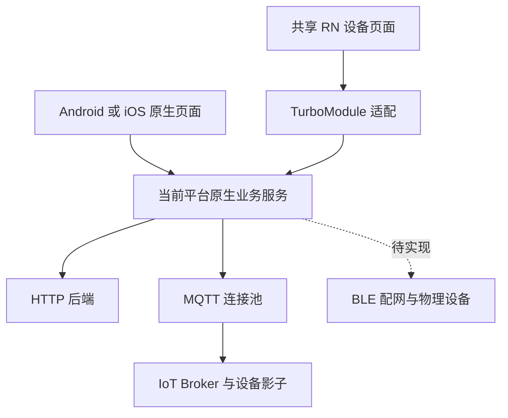

# 架构总览

更新：2026-11-09。ROWAN 采用原生主应用加共享 RN 设备模块，原生统一持有账号、设备通信和任务，RN 负责设备子流程展示。

## 阅读入口

| 文档 | 内容 |
| --- | --- |
| [模块分层与服务所有权](模块分层与服务所有权.md) | 模块依赖、服务装配和资源生命周期 |
| [原生与RN接入及桥接契约](原生与RN接入及桥接契约.md) | 容器、导航、方法、事件和兼容规则 |
| [设备通信与状态一致性](设备通信与状态一致性.md) | HTTP、MQTT、BLE 和状态恢复 |
| [核心业务流程与状态机](核心业务流程与状态机.md) | 账号、设备、解绑、配网和 OTA |
| [安全与数据管理](安全与数据管理.md) | 授权、凭据、存储和账号隔离 |
| [工程构建与交付](工程构建与交付.md) | 工具链、构建、资源和版本追溯 |
| [质量验证与可观测性](质量验证与可观测性.md) | 测试、运行证据、性能和诊断 |

## 系统结构

Android 和 iOS 各自部署、各自实现原生服务，共享 RN 源码及桥接规格。采用源码集成，RN Bundle 随宿主打包；TurboModule 只负责应用内调用。

## 范围与依据

- 唯一业务范围：[项目计划与需求范围](../prd/智能家居物联网项目计划&需求范围.xlsx)。
- HTTP 与 App 流程：[V1.4](../prd/ROWAN公共App产品功能及API详细设计说明书_V1.4.docx)；仅 MQTT 使用 [V1.6 Corrected](../prd/ROWAN_AS_App_Spec_V1.6_Corrected.docx)。
- 视觉：[蓝湖入口](../ui/蓝湖地址.txt)；代码约束：[代码规范](../SDD/原生与RN代码规范.md)。
- 原生页面包括账号、首页、房间、设置、添加、扫码和配网；RN 目标包括设备控制、更多、分享、定时和固件升级。

## 当前状态

| 部分 | 状态 |
| --- | --- |
| Android | 正式工程和服务已建立，有局部构建、接口及模拟器证据 |
| iOS | 工程和对应服务源码已建立，尚缺 macOS/Xcode 编译运行证据 |
| RN | 独立 RN 0.86.3 工程，已接设备观察、六类查询及原生确认解绑入口 |
| 控制与配网 | 控制组件未接正式入口；双端 BLE 与配网目录仍为空占位 |
| 验收 | 完整设备业务及真实硬件闭环尚未完成 |

`app-rn-old` 已删除，新工程不依赖旧工程。实现进度以[范围执行状态](../测试报告/重构实施-20261101/范围执行状态.json)和[实施证据](../测试报告/重构实施-20261101/README.md)为准，历史测试不能证明当前源码通过。

本组 8 份文档是当前架构入口；旧架构稿保留历史背景，协议核对和验收记录作为专题附件引用。未接入能力均按目标设计说明，不视为已交付。
