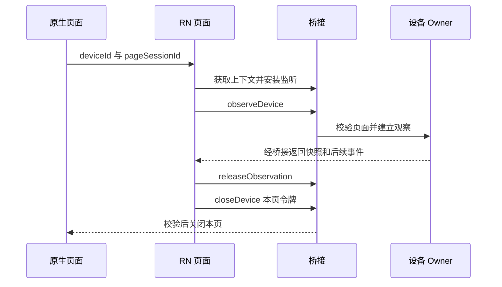
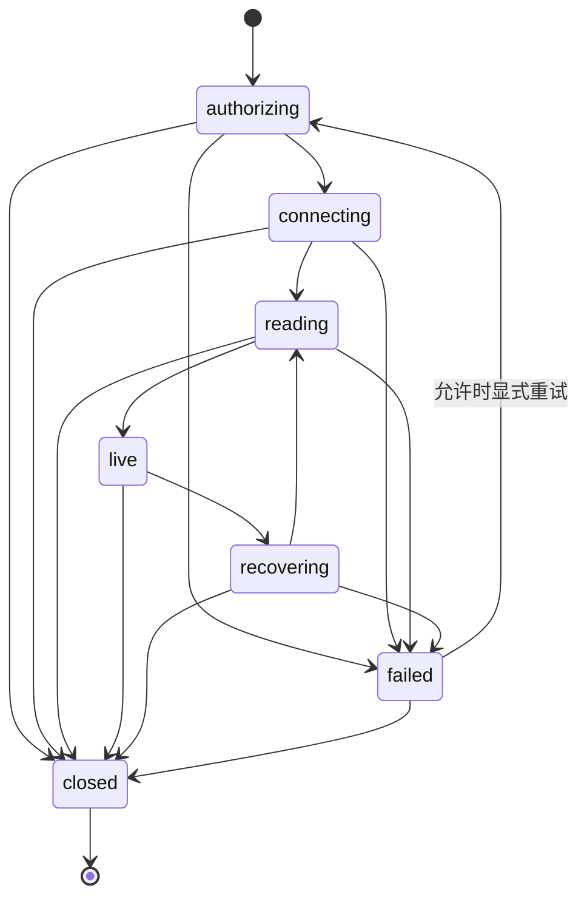

# 核心业务流程与状态机

[返回架构总览](架构总览.md)

## 账号与首页

启动读取安全存储 → 恢复或重新登录 → 建立账号上下文 → 读取首页和房间。退出或切换账号使旧修订失效，旧请求不得写入新账号状态；本地清理失败时不得继续按正常已登录处理。

账号及原生首页已有实现和局部验证，完整范围验收见[执行状态](../测试报告/重构实施-20261101/范围执行状态.json)。

## 进入设备与返回

当前入口展示状态，并进入更多、定时和固件查询；酒柜控制组件尚未接线。返回首页不应重建账号或重复创建通信所有者。

## 设备读取状态

该图概括生命周期；具体重试起点由 Owner 根据保留的授权和资源状态决定。closed 后通过新观察重新进入，旧回调失效。

## 设备业务

| 流程 | 当前实现 | 目标及失败边界 |
| --- | --- | --- |
| 控制 | 展示组件与部分能力校验 | 原生验证权限、物模型和条件，等 reported 确认；超时保留未知结果 |
| 更多与分享 | 摘要、成员、位置、帮助读取；分享码协议适配未接页面 | 生成凭据不得自动重放；关系变更后重新核权 |
| 定时 | 查询及基础服务 | 写入需要正式动作映射，列表空态不表示写流程通过 |
| 固件升级 | 候选查询及基础服务 | 原生拥有任务；离页不自动取消，重入查询恢复；firmware:null 语义待确认 |
| 自解绑 | RN 请求、原生确认、任务与恢复日志已接源码 | 不确定结果显式显示，完成首页新读与资源清理后才报成功 |
| 扫码与配网 | 扫码适配和页面已有源码，BLE 配网为空占位 | 明确二维码及 BLE 协议，绑定成功后刷新设备列表 |

原生确认解绑：校验观察和页面 → 原生展示设备名确认 → 用户确认后派发应用级任务 → 查询真实结果 → 清理设备授权与资源 → 首页重新读取。取消确认或关闭 RN 页面不撤销已经派发的任务。

## 协议与验收阻塞

全产品控制字段、配网帧格式及二维码规则、第二账号与隔离设备、固件空候选语义和真实硬件条件分别跟踪，不用 fixture 补成生产结论。详情见[范围映射](../SDD/重构范围逐项映射.md)、[控制字段核对](../SDD/全产品控制字段与范围差异核对.md)、[配网协议核对](../SDD/配网与扫码协议缺口核对.md)。
