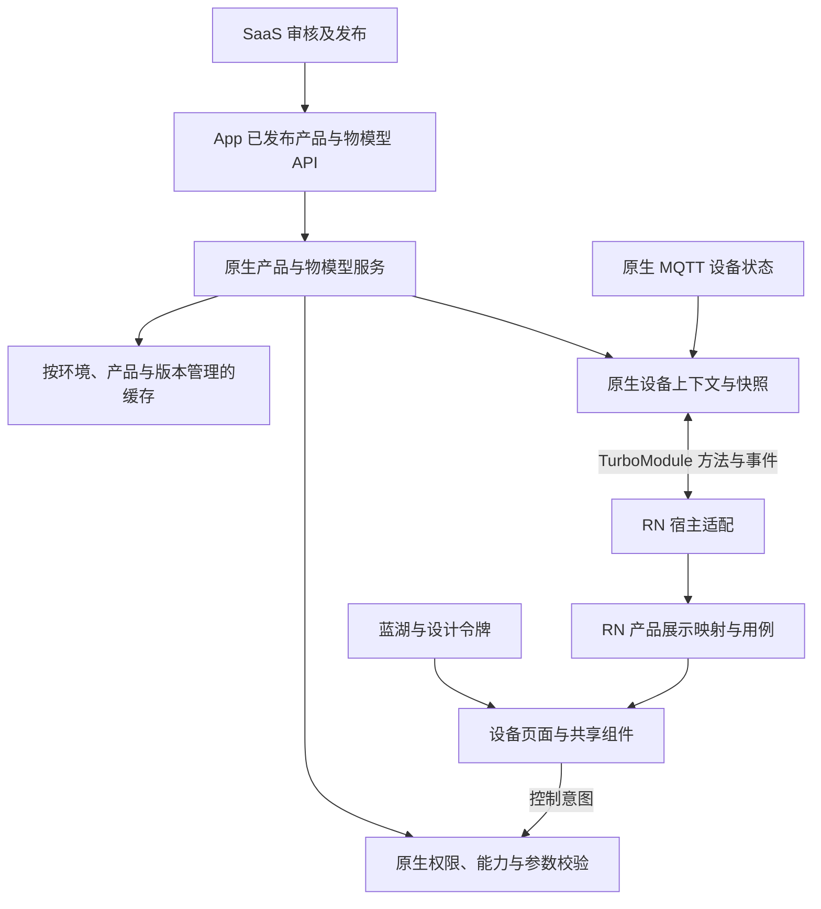
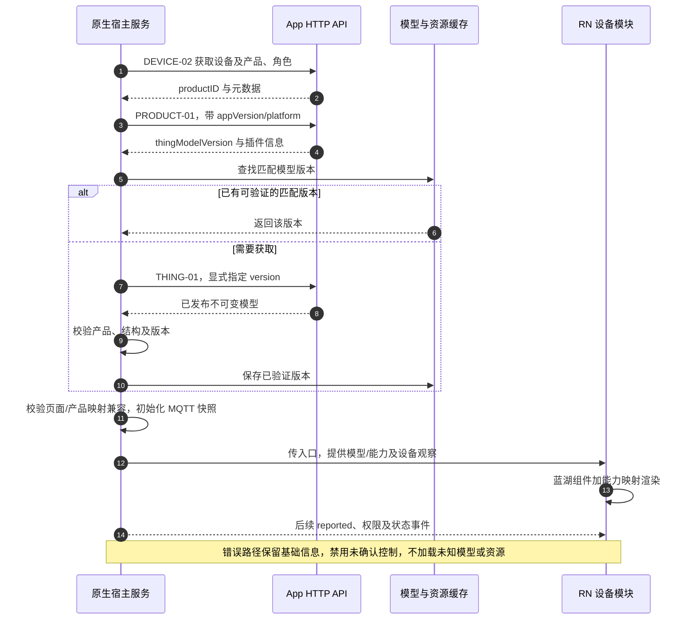

# 物模型架构与完整流程

日期：2026-11-01。性质：需求梳理及目标设计；不表示 PRODUCT-01、THING-01、插件服务或新宿主已部署可用。

原生/RN 职责、模型数据桥接与源码集成方式见 [原生与 RN 完整架构及接入文档](原生与RN完整架构及接入文档.md)。

## 1. 依据、范围与主要结论

主要依据：[V1.4](../prd/ROWAN公共App产品功能及API详细设计说明书_V1.4.docx) §4.3、§5.7、§8.16 PRODUCT-01、§8.17 THING-01/PLUGIN-01/02。MQTT 字段与状态语义仅参考 [V1.6 Corrected](../prd/ROWAN_AS_App_Spec_V1.6_Corrected.docx) §10，详见 [MQTT 架构与流程](MQTT架构与流程.md)。

与 [当前架构设计](../SDD/原生与RN架构及通信设计.md)、[代码规范](../SDD/原生与RN代码规范.md) 一起使用。**需求约束**、**设计建议**与**待确认**在下文分别标识。旧源码仅用于业务理解及结果对照，不要求保留旧类型、字段别名、控件架构或状态机。

**需求结论**：设备页需要获取已发布物模型，用于能力展示、通用组件及 MQTT 参数校验；物模型不是完整页面布局，也不是设备实时值。页面由蓝湖设计、RN 组件/产品映射、物模型、权限与实时状态共同决定。

唯一业务范围仍由根 AGENTS.md 指定的范围表约束；当前已由用户确认为 docs/prd/智能家居物联网项目计划&需求范围.xlsx；SDD 同名表为相同内容的副本。PRD 中“新增设计”接口及动态资源治理不等于后端已实现或新增平台已获授权。

## 2. 产品、物模型、页面与状态的区别

| 对象 | 含义 | 不代表什么 |
| --- | --- | --- |
| 设备实例 | 用户绑定的具体设备及角色、版本、productID | 不直接定义整类产品的能力全集 |
| 产品运行配置 | 已发布产品资料、thingModelVersion、插件入口及能力摘要 | 不提供实时运行值，也不保证接口已上线 |
| 物模型 | 属性、服务、事件的明确标识、数据约束和语义 | 不等于蓝湖布局、不等于 MQTT reported |
| 产品协议 profile | 原字段、值及设备动作/上报与业务能力的显式映射 | 不从产品名称、图片或示例字段猜测 |
| RN 页面/插件 | 控件、交互、内部导航、样式及产品展示映射 | 不持有生产连接或替代原生鉴权 |
| MQTT reported | 当前已确认或最近已确认的设备值 | 不因存在缓存就保证当前在线或值仍新鲜 |
| 用户权限 | 当前绑定角色及服务端实际授权 | 物模型 access=rw 不等于当前用户必可写 |

**需求约束**：SaaS 管理审核与发布，App 只读取已发布快照，不访问 /api/saas/* 或草稿；物模型版本不可变。具体产品字段全集仍需产品功能资料和电控协议确认，V1.4 的示例不是全集。

## 3. 架构与数据所有权



末尾 UI → Validate 表示经 RN 用例、适配和 TurboModule 返回原生的逻辑链，不是组件直接跨层调用。原生统一请求、校验、缓存和服务所有权；RN 持有经验证的展示模型及状态副本。两端共享语义契约和测试用例，平台实现可不同。

## 4. HTTP 接口完整关系

所有接口按 V1.4 使用 Bearer Token，错误及通用响应遵循正式 API 契约。下表路径是业务接口，不是 MQTT Topic。

| 接口 | 方法和路径 | 输入 | 主要职责 |
| --- | --- | --- | --- |
| DEVICE-02 | GET /api/app/devices/{deviceID} | 业务设备 ID | 获取 product、device、bindingRole、固件等元数据；实时值不靠持续轮询此接口 |
| PRODUCT-01 | GET /api/app/products/{productID}/runtime | productID；必填 appVersion、platform | 产品运行快照、模型版本及插件入口 |
| THING-01 | GET /api/app/products/{productID}/thing-model | productID；可选 version | 获取已发布物模型；省略 version 返回当前已发布版本 |
| PLUGIN-01 | GET /api/app/products/{productID}/plugin | productID；必填 platform、appVersion；可选 brandId | 匹配产品、平台及宿主版本的已发布插件元数据 |
| PLUGIN-02 | POST /api/app/plugins/{pluginId}/download | path pluginId；body version、platform、appVersion | 通过兼容校验后的短期下载地址与校验信息 |
| DEVICE-01 | GET /api/app/devices/{deviceID}/mqtt | 授权设备 | 独立获取实时通信会话，详见 MQTT 文档 |

platform 为 ios/android。brandId 只有插件确有品牌差异时使用，不用品牌名代替 productID。

### 4.1 PRODUCT-01 响应

| 字段 | 文档定义 |
| --- | --- |
| product | 名称、型号、图片、品类等产品数据 |
| thingModelVersion | 已发布物模型版本，例如 tm_3 |
| plugin | pluginId、version、entry 等入口信息 |
| capabilityHash | 能力摘要哈希，具体计算与比较契约待冻结 |

**需求约束**：仅返回已发布快照；配置版本变化后刷新模型与插件。1851 产品不存在、1852 产品未发布、1853 App 不兼容均需处理。

### 4.2 THING-01 响应

| 字段 | 用途 |
| --- | --- |
| version | 不可变物模型版本 |
| attributes | 属性标识、类型、范围、单位及读写权限 |
| services | 服务标识及输入/输出参数定义 |
| events | 事件标识、等级及参数定义 |
| etag | 缓存校验值 |

文档示例：

```json
{"version":"tm_3","attributes":[{"identifier":"power","dataType":"boolean","access":"rw"}],"services":[{"identifier":"resetFilter"}],"events":[{"identifier":"fault"}],"etag":"W/\"tm_3\""}
```

此为 data 的示例，不是全量生产 schema。power、resetFilter、fault 和 tm_3 均不能自动作为所有产品约定；数值范围、步长、复杂类型、服务入参及事件参数需取得真实完整定义。

**需求约束**：只读取已发布且不可变版本，MQTT 属性/服务/事件标识必须与该版本一致。模型不存在错误 1861、版本未发布错误 1862 必须明确展示和降级。

### 4.3 插件接口与物模型的关系

PLUGIN-01 提供 pluginId、version、entry、minAppVersion、sha256、signature；不存在匹配插件 1871、终止发布 1872 时按正式规则处理。宿主不兼容则使用内置降级页，不执行未知插件。

PLUGIN-02 提供 downloadUrl、expiresAt、size、sha256、signature；1873 版本不存在、1874 不兼容、1875 无下载权限需处理。下载后校验摘要和签名；下载、过期或校验失败删除临时包，回退上一有效版本。

这些是 V1.4 的设计接口。签名算法、公钥、清单与实际资源服务仍需确认；“读取物模型”和“远程执行 RN 包”是两种不同能力。首版可以使用匹配的包内页面，不因模型可获取就绕过资源执行兼容及范围要求。

## 5. 设备页初始化完整流程

**设计建议**：按以下依赖组织请求；独立请求可并发，但校验和激活不能越过依赖。

1. 原生验证账号、租户和设备授权，取得业务设备 ID，调用 DEVICE-02 获取 productID、绑定角色及设备版本。
2. 带当前宿主 appVersion/platform 调用 PRODUCT-01，取得已发布运行快照及 thingModelVersion。
3. 明确传该 thingModelVersion 调用 THING-01，优先使用相同版本的已验证缓存；不因接口允许省略 version 就随意获取最新。
4. 验证响应 version 与运行配置一致，结构和产品身份正确；核验当前产品 profile、页面映射及模型兼容性。
5. 选择匹配的包内或已验证 RN 页面；启用远程资源时按 PLUGIN-01/02 与资源安全设计校验，不加载未知/不兼容包。
6. 获取 MQTT 会话并按 V1.6 订阅及 get，取得已确认 reported；模型与数据同步可按依赖并发，但控制只在条件齐备时启用。
7. 原生形成一致设备上下文：产品、模型版本、能力、用户授权、单位约定、状态及修订；通过桥接交给 RN。
8. RN 按蓝湖布局、产品映射和能力渲染；未同步值保持加载/未知，不能从模型默认值推断设备实际值。
9. 后续 MQTT 更新实际状态；账号、权限、模型和页面资源变化分别按版本与上下文管理。



**待确认**：DEVICE-02 的业务 ID 与 MQTT thingRef 映射、PRODUCT-01/THING-01 的真实返回 schema、发布快照原子性、插件与模型精确兼容声明、接口部署及权限覆盖。

## 6. 控件如何从模型得到能力

物模型提供“能做什么及允许值”，蓝湖/组件提供“如何展示”，产品 profile 提供“业务语义与字段如何对应”。三者缺一时不能靠字段名猜测全部行为。

| 业务控件 | 模型与映射需要明确的信息 | 展示/控制规则 |
| --- | --- | --- |
| 开关 | 实际标识、类型、开/关取值、可写性 | 开/关可为 boolean、数值或枚举，不能默认 Power=1 |
| 温度/湿度滑杆 | 标识、数值类型、范围、步长、单位、有效条件 | 输入转换后在原生按设备单位重新校验；禁止越界和错误倍率 |
| 模式/档位 | 原始枚举及其展示映射、可写性 | 未知枚举明确显示未知，不默认选第一项或自动下发 |
| 计时/维护动作 | 对应属性或服务、参数、计次/清零语义、确认规则 | services 中存在动作不等于新增 service/call Topic；按 V1.6 映射原动作字段 |
| 故障提示 | 事件或属性定义、等级、参数、解除及映射 | 区分设备真实故障、通信错误及 UI 错误；不把所有事件都当 App 直订阅消息 |

可操作性应综合模型可写、用户授权、设备状态、产品运行条件、参数合法性及当前命令状态。模型 access 与角色不能互相代替，最终授权在原生和服务端执行。

**需求约束**：定时的 mode/action 根据产品能力校验，不跨产品写死枚举；即时设备控制走 MQTT。模型中有 services/events 不表示要为每个按钮增加 REST，也不表示 App 应订阅 V1.6 禁止直接消费的设备业务 Topic。

## 7. 控制及实时状态流程

1. RN 从模型和映射取得控件能力，从 reported 取得实际显示值。
2. 用户输入经 UI 约束后形成控制意图；RN 只携带明确业务值、设备及会话上下文。
3. 原生重新检查身份、角色、当前模型版本、属性/动作可写性、类型、范围、步长、枚举和条件。
4. 协议适配按原标识构造 Shadow desired；字段区分大小写，不能把 Power 擅自变成 power。
5. AWS 接受不算执行成功；原生根据有效 reported、目标及版本/动作关联确认结果。
6. 通过同一设备状态源通知原生首页和 RN；拒绝/超时/离线时显示真实状态或未知，不伪造成功。

页面与原生两次校验作用不同：页面改善输入体验，原生守住真实设备接口。RN 资源即使有错误也不能绕过原生校验。

## 8. 模型、运行配置、资源与设备值的版本关系

| 版本/标识 | 作用 |
| --- | --- |
| productID | 锚定产品身份，不用品牌或设备昵称代替 |
| thingModelVersion | 锚定不可变能力定义，不与 Shadow version 混用 |
| runtime 快照/能力摘要 | 描述本次产品运行选择；摘要算法及版本标识待确认 |
| plugin/bundleVersion | 页面资源版本，可覆盖多个产品或按产品族发布，粒度待冻结 |
| 宿主/桥接/引擎版本 | 原生能力及可执行资源兼容条件 |
| Shadow version | 当前影子状态的新旧依据，不是物模型版本 |
| 本地会话/观察修订 | 账号、设备及观察上下文隔离，不作为后端权限凭证 |

**设计建议**：构造经过校验的兼容组合再激活，包含环境、产品、模型、资源、宿主及桥接信息；保留明确当前上下文的原子切换，避免一半控件使用旧模型、一半使用新状态。

模型版本变化不意味着可直接替换正在操作的页面。重新获取兼容组合后在安全时机切换；未确认命令不得自动重放。所谓上一有效版本也必须适配当前产品/固件和宿主，不能盲目回滚旧资源。

## 9. 缓存、刷新与离线策略

- **需求约束**：模型只读已发布不可变版本，运行配置变化后刷新相关模型/插件。
- **设计建议**：模型以环境、productID、thingModelVersion 为主要缓存键；如内容具有租户/授权差异，再纳入相应隔离标识。设备运行值与模型缓存分开。
- 命中相同已验证版本可复用，不要求每次进入都下载完整模型。产品运行配置如何检查更新及刷新频率待正式策略冻结。
- 文档 data.etag 是缓存校验值，不自动等于已实现 HTTP ETag 响应头、If-None-Match 或 304；使用这些机制前确认服务端支持。
- 离线时可用匹配的已验证模型展示基础页面和最近确认值，并明确离线；没有匹配模型就降级，不能借缓存越权控制或擅自新增本地控制通道。
- 缓存过期/失效、账号切换和解绑后的设备关联数据按安全策略清理；公共不可变模型是否可跨账号保留需明确，但不得带入其他账号的设备状态。
- 摘要格式、计算对象及签名不能臆造。capabilityHash、etag、插件 sha256 各有用途，不能相互替代或推断同一种 Hash 算法。

## 10. 异常与降级矩阵

| 场景 | 行为 |
| --- | --- |
| 无设备权限/设备不存在 | 不进入可控设备上下文，清理失效关联 |
| 产品未发布或不兼容 | 展示明确状态，不读取 SaaS 草稿补齐 |
| 物模型不存在/版本未发布 | 可保留基础资料，禁用依赖模型的控制，不伪造空模型授权 |
| 运行配置指定版本与模型响应不符 | 拒绝激活该组合，重新同步并报告；不默用最新版本 |
| 模型结构非法、标识冲突或未知类型 | 隔离受影响能力；若核心结构不可用则整页降级，禁止错误下发 |
| 缺少产品字段/动作映射 | 控件不启用或明确提示不支持，不靠名称猜测 |
| 只读属性或用户无写权限 | 展示真实值但禁用操作，原生调用同样拒绝 |
| MQTT 未同步、字段未报或枚举未知 | 维持未知/加载，不填假值；仍可展示已确认基础资料 |
| 插件无匹配或校验失败 | 使用兼容的内置/上一有效页，未知包不执行；失败临时文件清理 |
| 请求响应迟到、切设备/切账号 | 依据上下文失效丢弃，不更新新页面 |

1861/1862、1851～1853、1871～1875 为 V1.4 所列业务错误；本地结构校验和超时错误码需在统一契约中定义，不自行冒充服务端已有错误码。

## 11. 原生与 RN 桥接边界

**设计建议**：原生通过 HostContext/Device 等类型化业务接口提供产品资料、匹配模型、已解析能力、状态快照与订阅；RN 不经任意 URL 接口自行请求模型或 MQTT 凭据。

- Codegen 只用所选 RN 版本支持的数据类型；传明确 DTO，不传服务对象、SDK 实例、业务闭包或 AbortSignal。
- 模型、产品映射和状态携带版本及设备/会话上下文；原生重新验证 RN 发起的意图。
- 观察建立与快照修订保持一致，RN 监听缓冲、渲染快照后应用有效增量，处理重复、缺口和过期事件。
- 展示组件通过 props/回调工作，用例/适配层管理桥接订阅。退出页面释放自己的观察，不误关首页或任务使用的连接。
- 语言、主题、显示单位与设备协议单位分别定义；不要仅因用户切换展示单位就假定应写入设备某属性，具体行为按 V1.4 与产品契约确认。

## 12. 旧实现参考与重构边界

旧工程会请求 thing-model，但不是完整新架构实现。其 [model 方法](../../app-rn-old/src/services/rowan.ts) 未显式传模型 version；[设备页](../../app-rn-old/src/screens/Device.tsx) 与 [runtime](../../app-rn-old/src/services/runtime.ts) 在 JS 中装配通信和上下文；[开发产品配置](../../app-rn-old/src/config/development-products.ts) 使用测试产品映射。

旧内部模型中的 type/writable 等字段不能直接替代 V1.4 示例 dataType/access；如果后端实际存在不同 schema，需要明确版本和规范化适配，不能假设二者天然等价。类型别名可重构，业务语义及真实字段映射必须保留正确。

复用资源、展示组件或测试向量须重新核验适用产品与版本，不把测试产品 Power/Online 的定义作为全局标准。新 RN 不引用旧 runtime，原生服务重新实现也应通过相同业务结果验收。

## 13. 验收与交付清单

- [ ] DEVICE-02、PRODUCT-01、THING-01 的权限、真实 schema、版本及错误返回已用后台验证。
- [ ] 草稿/未发布模型不可访问，不可变版本内容稳定，指定版本不会返回另一版。
- [ ] 明确产品字段、单位、类型、枚举、范围、步长、读写和动作语义，产品示例不混用。
- [ ] 蓝湖视觉、组件映射、模型能力、用户权限及 reported 实际值能逐项对应。
- [ ] 同一模型缓存复用、运行配置变更、离线、缺失模型、etag 行为及环境/账号隔离得到验证。
- [ ] RN 与原生均不会越权或越界控制；未知值/字段、只读、过期上下文和产品不匹配不产生错误命令。
- [ ] MQTT 标识、服务动作和确认机制按 V1.6，不引入旧 property/service/event 平行通道。
- [ ] 设备详情不持续轮询代替 MQTT；模型默认值不冒充实际状态。
- [ ] 模型与 RN 资源/宿主/桥接的兼容、包内降级及按授权实现的资源校验有真实证据。
- [ ] 双端各完成至少一个真实产品从初始化、展示、控制到确认的闭环，首页和设备页状态一致。

交付资料包括已发布真实模型样本、产品 profile/控件映射、版本兼容表、API 样例及错误清单、双端截图、受控收发证据、测试结果与来源 Commit。文档或单元测试不等于实际产品联调通过。

## 14. 待确认与来源索引

待确认：PRODUCT-01/THING-01/PLUGIN 接口实际实现状态、完整 JSON Schema、复杂类型/单位/倍率/边界表示、动作与事件真实字典、设备/固件对模型版本的适配关系、发布快照原子性、etag 协议、capabilityHash 算法、缓存刷新/失效策略、插件到模型精确兼容及签名契约。

| 来源 | 对应结论 |
| --- | --- |
| V1.4 §4.3 | SaaS 发布与 App 消费边界、草稿不可下发、模型版本不可变 |
| V1.4 §5.7 | DEVICE-02/PRODUCT-01、THING-01、插件及 MQTT 共同支持设备页 |
| V1.4 DEVICE-02 | 元数据、产品和绑定角色，实时状态不能用详情轮询替代 |
| V1.4 §8.16 PRODUCT-01 | 运行信息、thingModelVersion、插件入口及能力摘要 |
| V1.4 §8.17 THING-01 | 属性/服务/事件、version、etag 与发布校验 |
| V1.4 §8.17 PLUGIN-01/02 | 插件匹配、下载、签名/摘要校验及失败回退 |
| V1.4 scheduler UI 规则 | mode/action 依据产品能力，定时由云端保存执行 |
| V1.6 §10.2、10.4、10.7 | 原标识大小写、产品字典、Shadow 实际确认与幂等 |
