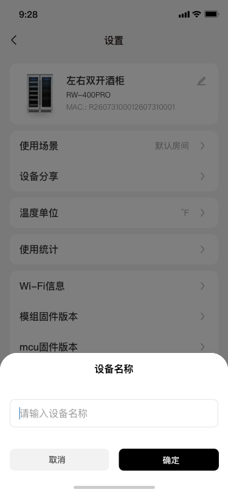

# 插件页-设备设置-重命名

归档序号：116；蓝湖页面 ID：未取得。

- [React 源码](index.jsx)
- [像素样式](assets/index.module.css)
- [rem 样式](assets/indexRem.module.css)
- [响应式样式](assets/indexResponse.module.css)
- [图片资源](assets/img/)
- [页面资料](page.json)
- [公共样式](../../assets/common.css)
- [设计图](design.png)

本地设计图保留原始字节，未认定为蓝湖最新版本；代码为蓝湖导出资料，未运行构建。
