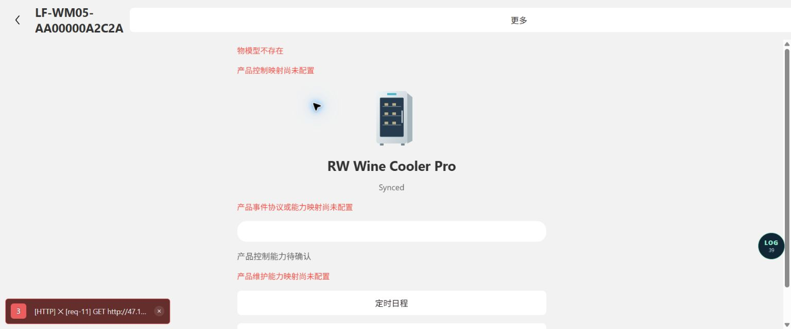
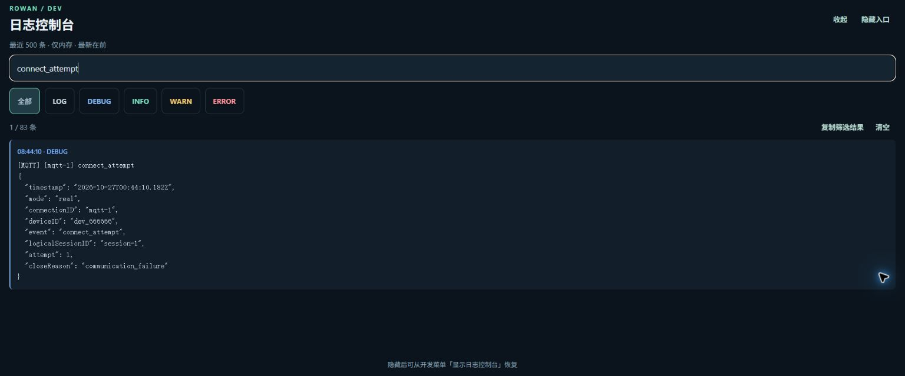
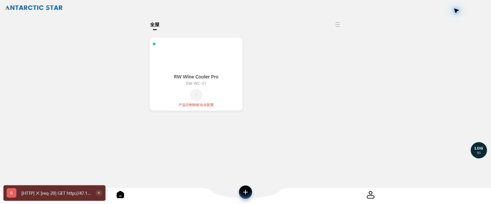

# MQTT 跨页面持有与同设备复用测试报告

日期：2026-10-27，Asia/Shanghai。变更：CHG-20261027-002。RF-0012、RF-0022 均更新至 4.0.0 / draft / in_progress；实现基于当前本地工作区，未提交、未发布。

## 实现结果

- Runtime 按当前登录上下文和 deviceID 缓存 ManagedDeviceSession，已有有效对象直接返回。底层停止或重连不删除逻辑会话；登录代次改变的旧对象不能继续使用。
- connect 在就绪状态幂等、连接中单飞；页面 AbortSignal 仅取消自己的等待。首页、设备页和配网流程不再 close 共享会话，页面仅取消局部请求及监听。
- AppProvider 统一通知 Runtime 前后台状态。后台不主动关闭、不启动自动重试，前台恢复已有失败会话；无观察者不淘汰。
- 退避基数 1/2/4/8/16/30 秒，随机增加不超过 20%，封顶 30 秒；全量同步成功重置。每次真实重连仍由原会话重新请求凭证、订阅和全量查询，不重放控制。
- 结构化区分 transient/authorization/not_found/configuration/cancelled。明确鉴权、设备不存在或本地契约缺失不自动重试；初始同步途中因断线产生的 499 保留底层真实失败类别，避免误判为页面取消。
- 退出/换号/解绑/Runtime 销毁关闭、清计时器并隔离旧回调；物理 MQTT 日志增加 logicalSessionID、attempt、closeReason。复用时不产生新的 connect_attempt。

主要实现入口：`src/protocol/managed-session.ts`、`src/services/runtime.ts`；页面和配网仅使用共享连接。没有新增依赖、云端接口、Topic、运行时模拟模式或产品控制映射；不增加提前换证调度。

## 实际验证

| 项目 | 本轮结果 | 原始证据 |
| --- | --- | --- |
| 最终全量测试 | **42 文件、542 项通过，0 失败**；使用 --maxWorkers=2 | [全量测试.json](全量测试.json) |
| 实际首页函数诊断 | **16 PASS / 0 FAIL / 0 ERROR** | [组件诊断.json](组件诊断.json) |
| lint | 退出码 0，无错误或警告 | [lint.log](lint.log) |
| 类型检查 | 退出码 0 | [typecheck.log](typecheck.log) |
| Prettier / git diff --check | 修改文件检查通过 | 已执行，退出码 0 |
| 规范索引与一致性 | 均退出码 1，历史来源缺失、CHG 断链；索引仍过期 | [索引检查.log](索引检查.log)、[规范检查.log](规范检查.log) |
| 真实 Web 跨页面现场操作 | **补验通过：首页→设备页→首页→设备页→更多→设备页→首页，始终同一连接**；后台/多房间/断线恢复仍未现场验收 | [Web现场验证.json](Web现场验证.json)、下方截图 |

测试环境：Windows / Node v24.10.0 / pnpm 11.19.0 / Vitest 4.1.11。初次高并发运行有 1 项既有 100ms 全量同步测试超时，并有相关未处理拒绝；完整失败 JSON 保留于[并发首次测试.json](并发首次测试.json)。隔离运行原文件 33 项通过；不改生产超时、不跳过测试，以两工作进程重新跑全部 542 项通过。该结果不证明高负载下原短超时测试稳定。

## 关键场景与验收映射

| 场景 | 实际断言 | AC 与结论 |
| --- | --- | --- |
| 多消费者、重复访问 | 同一 Runtime 同 device 返回同对象；并发连接和再次连接只调用一次凭证读取，物理端口 1 个、订阅/查询各 1 次 | RF-0012-AC-012、RF-0022-AC-020，本地通过 |
| 页面取消隔离 | 一个连接等待 AbortSignal 取消返回 499，另一个仍完成，连接未关闭 | RF-0022-AC-022，本地通过 |
| 离开首页/后台 | 更新原 UI-08 断言，连接调用 1 次、关闭 0 次；运行时后台切换不 end 连接 | RF-0012-AC-012，本地通过 |
| 网络掉线恢复 | 假时钟验证退避序列、单一计时器、抖动边界与 30 秒封顶；后台 120 秒不重试，回前台恢复 | RF-0022-AC-021，本地通过 |
| 全量同步中断线 | 真实 Realtime/Classic Shadow 代码构造 Broker，首轮中断后重新发 GET，收到 version=21 全量后 ready | RF-0022-AC-021，本地通过；测试先失败“只有 1 次 GET”，修正后通过 |
| 未确认控制断线 | Power 控制下发后断线，原等待被终止；恢复全量快照后状态替换，update 发布数量仍为 1 | RF-0022-AC-009/010/021，本地通过 |
| 永久错误 | 401/403/404 和标记 configuration 的 503 不重试；普通临时服务 503 会重试；CONNACK 后收到 broker code=5 不重试 | RF-0022-AC-021，本地通过 |
| 解绑、登录结束、换号、销毁 | 错误 owner 不释放；合法解绑关闭一次并移出池；clearLocal 触发登录终止清理，新 owner 获得新对象；dispose 关闭新连接，旧对象 connect 返回 499 | RF-0022-AC-020，本地通过 |
| 恢复后的卡片提示 | 初始失败提示可见，随后共享会话 ready/connected 事件清除旧错误，Online 圆点恢复绿色 | 组件 UI-16，本地通过 |
| 诊断上下文 | 日志保持相同 logicalSessionID/attempt，解绑关闭记录 device_unbound，历史事件不被后续上下文修改 | RF-0022-AC-022，本地通过 |

托管层用例 10 项；另有实际 Runtime、Shadow 协议及日志测试。组件诊断以受控 Hook/原生组件/导航替身执行实际 DeviceCard，未挂载原生渲染器；协议测试的 Broker/凭证均为自动化替身，不能冒充 AWS 或真机验收。

## 独立审查

执行计划技能要求的一次独立审查发现并修正：建立连接后的权限失败丢失分类、初始同步取消遮蔽底层网络失败、卡片恢复后保留旧错误、缺少产品信息的本地 503 被误当作临时错误。补充对应测试，复查未发现这些修正的剩余可操作问题。

## 验证限制与后续动作

- 首轮电脑操作工具无法可靠确认 Windows 浏览器 URL 而停止，该历史限制保留。用户后来安装并连接 Chrome 插件、恢复窗口，当前已完成下方真实跨页补验；没有绕过 URL 安全限制。前后台及真实 AWS 断线恢复仍未现场验收。
- 手工现场验证应在首次连接后记录 logicalSessionID/attempt，首页进入设备页再返回、切房间或 Mine、切换浏览器标签页；这些动作不得新增 connect_attempt/close_requested。真实网络故障恢复应看到同一逻辑 ID 的 attempt 增加、重新凭证/订阅/全量 get。不要通过控制设备来验证连接复用。
- 规范检查仍因历史平台/物联网 OpenAPI、MQTT 接口快照缺失及旧 CHG 链接断开而失败；index 在校验阶段停止，未手工改索引或绕过来源哈希。恢复历史资料后需重新执行 specs:index/check，当前两份规范的新版本尚未同步进生成索引。
- 后台网络仍可能被系统暂停或回收；本轮承诺不主动关闭，不承诺系统级后台持续运行。产品在线/控制映射及物模型缺口不在此次生命周期变更中补齐。

## 复现命令

```powershell
pnpm exec vitest run src --maxWorkers=2 --reporter=default --reporter=json --outputFile=sdd/迭代变更/变更-20261027-002/全量测试.json
node scripts/首页MQTT验收诊断.mjs sdd/迭代变更/变更-20261027-002/组件诊断.json
pnpm lint
pnpm typecheck
pnpm specs:index
pnpm specs:check
```

实现取舍（Ruling）：用独立托管层包装原协议会话，保留低层一次连接语义；代价是增加一层状态转发，已通过实际 Runtime 与恢复路径测试。没有未处理的独立审查缺陷；Web 后台/恢复及规范检查属于明确未完成项，不标记 verified/released。

## Chrome 插件连接后的真实 Web 补验（2026-10-27）

用户明确允许重试，授权登录表单的协议勾选和测试登录，并手动恢复了 Chrome。重新读取时页面已位于 `http://localhost:8081/home` 且已登录，设备为 dev_666666。此前旧页面曾出现 Metro unknown module 3625 / MQTT连接创建超时，重新加载后本轮基线已取得实际 connected、四个 SUBACK 和 GET accepted；不将旧错误解释为本轮复用失败，也不据此宣称所有 Metro 问题已修复。

本轮观察窗口内，首次 connect_attempt 为北京时间 **08:44:10.182**，connected 为 **08:44:13.112**，GET accepted 为 **08:44:16.834**；最后统计为 **08:46:41.849**。均来自浏览器控制台事件及保存的结束时间。

| 实际操作 | connect_attempt | SUBACK | GET 发布 | close_requested / disconnected | 逻辑/物理连接 |
| --- | --- | --- | --- | --- | --- |
| 首页连接基线 | 1 | 4 | 1 | 0 / 0 | session-1 / mqtt-1，attempt=1 |
| 点击卡片进入设备页，等待显示 Synced | 1 | 4 | 1 | 0 / 0 | 相同 |
| 点击 Back 返回首页 | 1 | 4 | 1 | 0 / 0 | 相同 |
| 再次进入设备页并点击“更多” | 1 | 4 | 1 | 0 / 0 | 相同 |
| 从更多页经设备页返回首页 | 1 | 4 | 1 | 0 / 0 | 相同 |
| 最终统计 | 1 | 4 | 1 | 0 / 0 | 相同 |

设备页实际显示 Synced：首页与设备页来回没有重新连接或重新订阅。首页圆点为绿色，无可见在线/未知文字，电源仍因控制映射缺失而禁用。逻辑对象身份的一致性由前述 Runtime 单元测试证明；本轮浏览器只核对公开页面和连接日志，没有读取 React 私有状态或注入模拟消息。

现场发布订阅流程：连接成功 → 订阅 `$aws/things/dev_666666/shadow/{get,update}/{accepted,rejected}` 四个响应主题并收到四个 SUBACK → 发布一次 `/get` 并收到 PUBACK → 收到 `/get/accepted` → 页面切换继续使用这组订阅。实际响应版本为 **41**，保存的 reported 字段如下（选择性脱敏摘录，不是完整报文）：

```json
{"Online":"online","Power":"on","TargetTemp":10,"TempCurrent":10}
```

没有 `/update` 控制发布。保存的事件上下文带有默认 closeReason=communication_failure，此字段本身不是断线证据；本轮 close_requested 和 disconnected 事件均为零。

保留的现场截图：







边界及未验收项：

- 临时测试标签页没有变为活动页，原页面 document.visibilityState 仍为 visible；插件对 tabs.update 的 active 属性不支持，因此本轮不能计为真实后台测试通过。未尝试绕过受限方法，临时页已关闭，恢复原首页与收起的控制台。
- 房间菜单只有“全屋”，没有其他可切换房间；未新建房间或修改归属来制造验收数据。多房间切换没有现场样本。
- 更多页有既有“Unexpected text node”警告；物模型接口仍报 1050186001“物模型不存在”，产品控制/事件/维护映射仍缺失。这里只验证导航时 MQTT 生命周期，不宣称更多页业务和控制能力验收通过。
- 没有下发设备控制、解绑、改变房间、清空日志或执行真实网络故障。真实断线自动恢复仍以前述构造端口/假时钟测试为证，不冒充本轮 Web 验收。
- 本轮仅补充浏览器操作、脱敏连接统计和截图，未修改业务代码，未重新执行前述 542 项单元测试、lint 或类型检查。
- 补验后重新执行 `pnpm specs:index` 和 `pnpm specs:check`，两者退出码仍为 1：历史来源资料/CHG 本地链接缺失，索引生成被校验阻止，check 同时报索引过期。新日志保存在 [现场补验索引检查.log](现场补验索引检查.log) 和 [现场补验规范检查.log](现场补验规范检查.log)，未绕过校验或手改索引。

## 用户授权提交后的最终检查（2026-10-27）

提交前重新执行 lint、类型检查，退出码均为 0；首页组件诊断 16 项通过、0 失败、0 错误。全量测试在 Windows 沙箱中因临时缓存 rename EPERM 导致 42 个文件未加载、未执行任何用例，失败证据保留在 [提交前测试.log](提交前测试.log)。在正常执行环境原样重跑 `pnpm exec vitest run src --maxWorkers=2`，最终 **42 文件、542 项全部通过**，没有跳过用例，见 [提交前全量测试.log](提交前全量测试.log)。未改业务代码以规避沙箱错误。

提交前已 fetch origin，master 与 origin/master 无分叉；变更文本扫描未检出私钥、AWS 访问密钥、JWT、AWS 签名 URL 或用户提供的登录口令。规范检查的历史阻塞及真实后台/多房间/网络故障恢复未验收项继续保留，提交推送不代表发布或将交付状态改为 verified/released。
